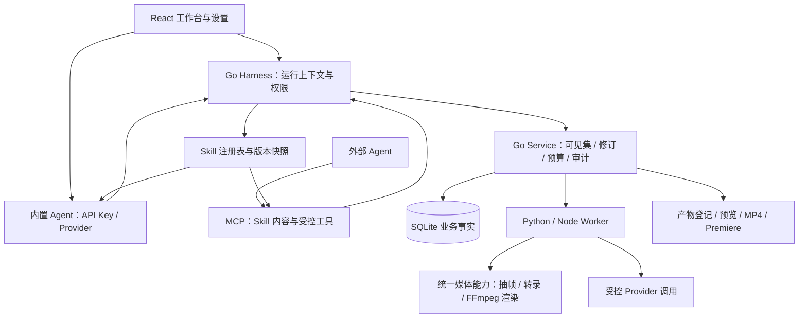

# Skill 双流程架构设计

> 2026-10-19 实施更新：当前改造分支为 `agent/vu-skill`，工作区 `.run-data/worktrees/codex-skill-harness`。项目 scope、Skill/Harness、MCP/API Agent、共享媒体/交付与旧链脚本消费已写入；前端提供类型/调用和 SSE 契约，布局待接入。见 [接口交接](Skill-Harness接口与前端交接.md) 与 [实施及实际验证](Skill架构实施与验证-2026-10-19.md)。以下设计前的状态/命令保留原时间与范围，不作为本轮已验收结论。


设计日期：2026-10-19。状态：**设计阶段合同；底层及接口已在 agent/vu-skill 实施，实际状态见顶部交接与验证文档**。下文保留设计阶段的草案、预期及当时未实施说明，不作为当前接口清单。原始设计依据[方案](Skill管理与双流程改造方案-2026-10-19.md)及用户补充：外部 Agent 经 MCP 获取 Skill，内置 Agent 经配置 API Key 使用 Skill。

本文保留架构设计来源；[当前架构与接口](当前架构与接口.md)记录现有实现及落地选择，[当前工作与待办](当前工作与待办.md)记录执行状态。原方案提供需求背景。实施已固定并纳入上游说明与选定参考文件，未执行上游安装提示或发起真实外部模型请求。

## 1. 基线与三个独立维度

静态核对基线为 `agent/develop@f1a75df` 加工作区未提交 F2–F4 续作；根目录 `agent/test-workspace` 是旧源码及测试管理入口。已有能力保留，未验证的接线不能视为可用产品。

| 维度 | 选择 | 含义 |
|---|---|---|
| 素材处理流程 | A：`lightweight`；B：`visual_heavy`；`custom` | 口播转录优先，或复杂画面摘要优先；custom 是显式配置组合 |
| Agent 执行方式 | `external_mcp`；`builtin_api` | 外部 Agent 自行推理并调用 VAC，或 VAC 内置 Agent 使用 Provider API |
| 脚本创作方式 | `manual`；`agent_generated` | 人写或 Agent 生成，均遵守可见集、修订和定稿规则 |

三个维度可以组合。旧 F2 文档“路径 A 人写 / 路径 B Agent 写稿”改称“手写路径 / Agent 生成路径”，不等于新流程 A/B。两种 Agent 模式共用 Skill 内容和工具语义；无需为 MCP 模式重复配置 VAC 的推理模型 Key。VAC 代执行的转录、TTS 或多模态请求仍需要其相应 Provider 配置与授权。

## 2. 底层框架



Tauri 继续只承担桌面集成、文件选择、后台监督与更新。业务经 Go HTTP/MCP；SSE 通知后重新读 REST 快照。Worker 不直接写 SQLite。

**Agent 解释 Skill；Harness 管理运行；工具执行具体动作。** `SKILL.md` 是给 Agent 的能力说明，不是 Go 可直接解析的任务程序。无需把每个 Skill 翻译成硬编码固定流程。Go 限制工具访问、运行身份、预算和发布；已知媒体动作由可测试的 Worker 执行。

两种执行方式：

1. **外部 MCP**：Agent 列举 Skill → 读取选定版本的完整 Skill 及 VAC 适配说明 → 创建绑定项目的 run → 读取可见素材/脚本/摘要 → 推理并调用受控工具 → 提交编排草案 → 等待必要人工决定 → 请求渲染/检查/发布。Skill 正文通过 MCP 返回，不依赖 Agent 能访问 VAC 本机安装路径；引用的说明资源按版本读取。媒体只以受控资源或取帧接口提供。外部 Agent 自己的模型和会话由外部宿主管理，VAC 不额外嵌套一次推理。
2. **内置 API**：用户选择推理 Provider/模型并配置凭证 → 内置 Agent 装载同版 Skill、输入快照及工具描述 → 循环执行模型请求与工具调用 → 将工具结果回给模型 → 在等待人工、完成、失败或预算耗尽时退出/暂停。复用现有 Provider 和生成能力，补足通用 Skill 上下文、工具调用与恢复机制；现有单次生成接口不等于完整 Skill Agent 循环。

MCP 的授权绑定真实会话身份与 project/run scope，不信任参数中的 `actor=human:*`。外部 Agent 即使已获得 Skill，也不能通过工具代做 F1/F2 人工确认。把 Skill 交给 Agent 即可获得其使用说明，但 VAC 仍须提供对应工具能力，不承诺任意本机 shell 脚本都能透过 MCP 执行。

## 3. 功能模块与复用落点

| 模块 | 保留/复用 | 新增职责 |
|---|---|---|
| 项目与素材 | ingest、assets、visible_set.go、0018 | 项目目录、project_assets 归属、项目级可见集与确认 |
| Skill 管理 | skills/vac-script-syntax | 元数据、版本/来源/摘要、全局启用、项目覆盖、按流程默认、依赖校验 |
| Harness | service、队列、审计、auto 预算与决策语义 | Skill run、输入快照、工具白名单、租约/取消/重试、结果复验 |
| Agent | 既有 MCP server、Provider 与 Python 生成入口 | MCP Skill 内容分发；内置工具调用循环；共同 run 上下文 |
| 脚本与编排 | 0019、script_workbench.go、script_voice.go | Skill 草案转既有修订；显式语法块优先；统一编排引用 |
| 媒体能力 | script_runtime.go、timeline-cli、export-worker | 收敛抽帧、转录、音频、字幕、FFmpeg 能力及渲染出口 |
| 交付 | script_delivery.go、previews、delivery-variants | Skill 产物登记、同版预览/MP4/可选 Premiere 与过期失效 |
| 自动模式 | auto_driver.go 与现有人工动作 | scope 加 Skill/执行方式/项目；复用决策卡；旧链兼容迁移 |

现有直接脚本链已有 Go 调 Python/Node 和 FFmpeg 渲染基础；S3 是统一接口及能力探测，不是从零再造渲染器。F2 保留段落、F3 TTS 回写/直接合成、F4 交付接线已写入未提交源码，未验证。旧自动链只核对脚本范围，未完整消费段落稿；此缺口在新架构下仍要闭合。

## 4. Skill 包与运行契约

包包含 Agent 说明 `SKILL.md` 和可校验元数据（建议 `skill.json`，字段在实现时固化 schema）。至少声明 `id/name/description/version/source/entry/runtime/inputs/outputs/permissions/compatible_flows`，另加 `content_sha256`、`execution_modes`、`required_capabilities`、依赖版本范围及 upstream 信息。

原方案的 `runtime` 是兼容性声明，不是 Markdown 解释器：`instructions_only` 表示只供 Agent 推理；`harness` 表示 Agent 可在 VAC run 中调用声明的工具；`external_cli` 首版不启用。本地导入只读取、校验并快照说明和资源，不自动运行安装脚本、shell 或下载依赖。builtin 不可卸载，可禁用。全局禁用是硬门；项目只能收紧启用范围或覆盖默认选择。可用性由流程、执行方式和工具能力共同判断。

单次 run 固定：project、flow、执行方式、Skill ID/版本/内容摘要、可见集版本与 SHA、资产版本/内容摘要、脚本 ID/精确修订（若已有）、Provider 版本与授权引用、参数、预算、幂等键。Skill 升版不修改在途快照；撤销权限或禁用后禁止新工具动作，并终止/取消未完成操作。旧产物按原身份保留审计，不自动变成新版本。

建议独立 `skill_runs` 状态：`queued/running/waiting_human/succeeded/failed/cancelled`；不扩展脚本四态。工具任务使用既有队列执行机制；Agent 会话另存检查点和租约。MCP 断连到期后暂停/失效租约，恢复需核对快照，不能重复计费或覆盖更新后的稿件。失败分类包含依赖缺失、凭证缺失、授权不足、版本冲突、模型失败、渲染失败、预算不足；重试仅重跑允许的失败步骤并记录消耗。

外部 Agent 的模型费用不一定可观测：预算明确区分 VAC 可计量的工具成本和外部推理成本未知，不声称全部可控。内置 Agent 限制模型轮数、token/费用、时长与重剪次数。模型自评可以建议修改，不能写人工验收通过。

## 5. 两条产品流程与定稿

### A：轻量直出

创建项目 → 导入并确认可见集 → 选 video-use 和 Agent 执行方式 → 自然语言目标 → 转录/按需取帧 → Agent 提出策略与编排草案 → 确认范围内的定稿 → 统一 FFmpeg 渲染 → 切点检查 → MP4 站内预览。Premiere 为可选输出，用户无需手写 EDL 或完整特殊语法。

自然语言目标仍产生可审计的脚本/编排修订。手动模式由用户定稿；自动模式沿用既有 G1 显式授权范围，修改、重生成或超范围时必须停卡，不能以“一键成片”绕过人工门。未定稿试跑如实现，仅产预览草稿，不能发布正式交付或清除旧交付失效标记。

### B：画面主导

创建项目 → 导入并确认可见集 → 关键帧提取 → 多模态内容大意 → 用户脚本与大意共同编排 → 人工定稿/授权门 → FFmpeg MP4 和/或 Premiere 序列。ASR 不作为前置条件。摘要可由内置多模态 Provider 生成，也可由具备视觉能力且获授权的外部 Agent 读取受控帧后提交；无视觉能力时明确阻塞并提示配置，不伪造大意。

抽帧先低分辨率探测变化，连续剧变候选默认每 3 个保留 1 个；N、时间间隔、每窗口/每资产/每 run 预算可配置。明确候选检测频率、阈值、时间窗、采样序号、源 PTS/time_base 和算法版本。首尾帧及低变化长区间保底采样也计入预算，避免静止画面完全无摘要。三抽一是初始策略，未证明对所有游戏最优。超过预算停止并呈现候选数、预算与调整方案；经用户选择再重算，不静默删素材。

`keyframes` 清单记录 asset ID/内容摘要、源时间戳、受控图片引用、变化分数、选取/抽稀原因及策略快照。`content_summary` 保存模型身份、可见集、帧清单摘要、时间段要点、置信度、证据帧和叙事节拍；静态帧无法证明的动作标不确定。Agent 编排优先读摘要与脚本，需要复核时再取帧。

两条流程都把结果归一为 VAC 的受控时间线/EDL 引用，Go 校验资产属于项目及可见集、窗口合法、字幕/音轨时间轴和修订身份。video-use 的 EDL 需适配，不能仅因文件同名就视为符合现有契约。

## 6. 项目目录与数据迁移

```text
<projects_root>/<project_id>/
  project.json
  media/
  visible/                 # 可选快照
  scripts/                 # 可选修订镜像
  keyframes/<extraction_id>/
  summaries/<summary_id>/
  skill-runs/<run_id>/      # input、output、日志和检查点
  renders/<delivery_id>/
  delivery/<delivery_id>/
  audit/                   # 可选可读镜像
```

SQLite 是事实来源，project.json 和文件镜像不是第二套可写数据库。导入需先取得合法目标与项目身份，完成托管副本/校验并登记资产后才可进入可见集；半成品不可见。首版使用托管副本或登记的原有只读资产，不把任意 symlink 当权限边界。Worker 可以解析受控本机路径，Agent 只获得资产 ID/授权引用；写入路径须核验 project/run 归属及重解析点，下载由 Go 校验产物身份。

**现有 F1 可见集是全局集合**：`loadVisibleSet` 从资产库读取 AgentVisible；其 SHA 基于资产 ID，不能直接冒充项目隔离或内容指纹。迁移要新增项目关联、项目级确认及显式 scope 版本；旧 SHA 算法不原地改义，新 run 同时绑定项目和资产版本/内容摘要。

建议新增 projects、project_assets、skill_packages、project_skill_settings、skill_runs/steps/artifacts 和项目确认记录；精确表名及迁移编号留给新分支，当前迁移止于 0019。旧资产/脚本/运行归入兼容项目或建立映射，不自动搬动业务文件、不伪造新项目人工确认。旧在途 run 保留 legacy scope，旧 JSON/下载契约不破坏；新建项目和 Skill run 强制新 scope。先核对映射数量与交付引用，再允许切换入口。回退到旧入口时保留新记录和文件，不删除业务数据。

## 7. 对应接口（全部为设计草案）

以下不写入现有已实现 API JSON；落地后按源码注册更新清单。HTTP 与 MCP 调同一 Go service，外部调用不能因通道不同放宽授权。

| 领域 | HTTP 草案 | MCP 工具草案 |
|---|---|---|
| 项目 | GET/POST `/api/projects`；GET/PATCH `/api/projects/{id}` | `projects.list/get`，写入按权限开放 |
| 项目可见集 | GET `/api/projects/{id}/visible-set`；POST `.../visible-set/confirm` | `projects.visible_set.get`；人工确认不开放给 Agent |
| Skill 管理 | GET/POST `/api/skills`；GET/PATCH `/api/skills/{id}`；POST `.../validate` | `skills.list/get`，管理写入限用户设置 |
| Skill 内容 | GET `/api/skills/{id}/content?version=...` | `skills.get` 返回正文、摘要、VAC 说明及可读资源索引；`skills.read_resource` 读取包内说明 |
| 项目设置 | GET/PUT `/api/projects/{id}/skill-settings` | 运行只读取有效配置 |
| 运行 | POST/GET `/api/skill-runs`；GET `/api/skill-runs/{id}`；POST `.../cancel`、`.../resume` | `skill_runs.create/get/cancel/resume`，恢复不得代替人工批准 |
| 媒体与编排 | 项目媒体视图、抽帧、摘要、草案提交适配现有 service | `media.list/get_frames/transcribe`、`summaries.get/submit`、`scripts.propose` |
| 渲染 | GET `/api/system/ffmpeg`；POST `/api/projects/{id}/exports/ffmpeg` | `renders.create/get`，仅接受合法编排引用与意图参数 |
| 产物 | 复用受控 previews/delivery 文件读取，补项目/run 绑定 | `artifacts.list/get`，不返回任意磁盘读能力 |

创建 run 包含 `project_id/flow/execution_mode/skill_id/skill_version/visible_set_sha/script_revision?/params/idempotency_key`，Provider 和授权引用由 Go 校验。MCP 只读 Skill 说明不产生媒体外发授权；第一次获取媒体/转录/摘要时仍核对 scope。本地 Key 不随 Skill、输入包或 MCP 响应交给外部 Agent。

工具执行前与结果提交前均核对权限及身份；过期版本返回冲突，不发布迟到产物。新写接口使用幂等键、预期版本；取消终止下游进程/请求并阻止迟到发布。事件建议 `skill.changed`、`skill.run.changed`、`project.changed`；实现时接既有 SSE 刷新机制。

## 8. 显示界面与状态

- 保留资源、编辑、导出、TTS、设置五工作区。新建项目提供 A/B/custom 模板，明确适用素材。
- 设置增加 Skill 分页：原生标记、版本、启用、局部导入、依赖校验、按流程默认；Agent 设置区分外部 MCP 连接说明与内置 API Provider，沿用既有凭证处理机制。
- 工作台顶部显示项目、流程、Skill 与执行方式。MCP 模式显示待外部 Agent 连接/接管、进度和人工决策；内置模式在预检通过后运行。两种模式都可查看策略、草案、来源及预算。
- 自动授权页列明 `skill_id@version`、摘要、模式、项目可见集、Provider 外发对象和定稿范围。切换流程/Skill/模式使旧授权失效；旧结果保留但标过期，新结果不得覆盖旧修订。
- 查询键至少含 project、run、Skill 版本、script/version 和可见集；切项目取消旧请求、停隐藏页播放器，旧请求回包不能污染新项目。设置持久化在 Go，localStorage 不保存授权或凭证。
- 导出页区分草稿预览、正式 MP4 与 Premiere 包；TTS 细调仍在专页。遵守现有 ui-style-spec，不启动自绘时间轴等后置项。

## 9. video-use 纳入边界与来源

2026-10-19 阅读上游 [README](https://github.com/browser-use/video-use)、[SKILL.md](https://github.com/browser-use/video-use/blob/main/SKILL.md)、[依赖声明](https://github.com/browser-use/video-use/blob/main/pyproject.toml)和 [MIT LICENSE](https://github.com/browser-use/video-use/blob/main/LICENSE)，仅静态调研，未运行。上游提供 Agent 指令及 Python 辅助脚本，转录采用 ElevenLabs，使用 FFmpeg，并按需查画面、渲染后检查切点。它面向多类视频；VAC 首版将其限定流程 A 是集成范围决策，不是声称上游只能剪口播。

目标将 upstream 原件、LICENSE、固定 commit 与文件摘要保留在 `skills/video-use/upstream/`，VAC 入口说明和适配清单单独维护。当前只读 main 页面，**未锁定 vendor commit**，实施 S4 前必须固定并重新审查。Python 声明要求 >=3.10；实际发行还需核对依赖、FFmpeg 与可选动画能力。

VAC 适配负责将原始目录/EDL 路径换成受控素材引用，把会话输出归入项目 run，把 Provider 请求与渲染接回共同工具。上游特定转录服务可作为 VAC 可选 Provider；其他转录服务必须满足词级时间戳等所需能力才可替换。缺能力时明确报错或由用户切流程 B。动态动画代码执行、自动下载和任意 filter/shell 不纳入首版承诺；未支持意图返回明确结果，不悄悄丢弃。自检次数纳入共同预算，质量仍需独立实测。

## 10. 实施切片与验收合同

之后在新分支实施，本轮不创建分支、不写产品代码。先带入并审查 develop 的未提交续作，避免覆盖既有工作。推荐依赖：S0 → S1 → S2；S3 在共享契约确定后进行；S4 依赖 S2/S3；S5 复用 S2/S3；S6 收口，不把权限检查推迟到最后。

| 切片 | 交付与边界 | 必须可证伪的验收（目前全部未执行） |
|---|---|---|
| S0 | 本轮文档、命名、目录与接口设计 | 当前/目标分离，旧文档能找到新入口，MCP/API 两种模式完整 |
| S1 | 项目 scope、Skill 注册/版本/设置和本地导入 | 跨项目拒绝；全局禁用生效；导入不执行代码；旧项目/资产引用可读 |
| S2 | Agent 双入口、MCP Skill 分发、run 与受控工具 | 无 VAC 推理 Key 的外部 Agent 可取得 Skill 并执行工具；内置 API 能完成工具往返；两者均拒绝假人工确认；断连/取消/重试无重复发布 |
| S3 | 统一 FFmpeg 能力与交付 | 工作台/Skill/旧 export 共用能力；字幕/混音及原交付不回退；非法路径、过期修订、渲染失败不发布 |
| S4 | 内置 video-use 适配 | 两种 Agent 模式各完成口播项目→MP4；无手写 EDL/Premiere 依赖；缺 Key 可读失败，产物不串项目 |
| S5 | 抽帧/摘要/编排及双出口 | 无 ASR 游戏样片可生成草案；连续剧变、低变化与超预算策略可复跑；MP4 与 Premiere 同一修订；模型质量另验 |
| S6 | 引导、自动授权与旧链兼容收口 | 范围变化停卡；Skill 身份可追溯；旧自动链不交付与定稿不一致的内容；用户确认后再决定迁移旧入口 |

DEV02–DEV04 未验证实现作为复用输入；DEV05 旧自动链缺口映射 S2/S6，不删除挂账，也不要求先沿旧架构全部扩建再做 Harness。F0/F1 已有门禁及 F2–F4/G1–G4 验收继续有效。B04、CR03、真实模型质量、Premiere 实机导入和桌面发行保持独立待办。

旧链保留为兼容入口，待 S4/S5 和迁移验收后再决定是否包装 `vac-legacy-pipeline` 及废弃时间。验证恢复后统一使用版本化测试入口，按 `test-governance` Skill 与[测试维护入口](../scripts/TESTING.md)管理套件、样本及生成物，不设固定容量上限；工程检查、真实运行、模型质量和人工验收分别记录。任何历史通过均不覆盖本次新设计。
