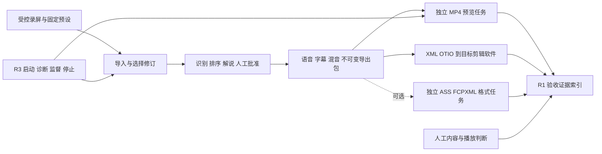

# 后续模块开发框架与 Agent 交接方案

日期：2026-10-07。适用仓库：`E:\AI\Video Auto Cut`。状态：**ASS 首版与共用 delivery_variant 任务框架已实现；R1/R2/R3/R5 仍按后续计划推进。**

本方案承接 [MP4 修复复验](远程同步与MP4预览修复复验-2026-10-07.md)，对照 `IDEA.md`、原始开发文档与当前代码。原始目标仍是 Agent 粗剪、Premiere/Resolve 人工精修，Go 管理业务状态，EDL 管理时间线；保持现有文件交接主路径。

修复更新：已完成 [MP4 稳定性缺陷修复与复验](MP4稳定性问题修复与复验-2026-10-07.md)，覆盖任务期限、探测/编码取消、输出路径、恢复绑定、时间线画布与重叠检查。接收者使用下方修复后源码指纹。R2 的完整规模矩阵与 R1 真人业务验收仍待执行。

## 1. 还要做什么

一至七阶段、服务商接入和 MP4 预览主链路都有实现。真正尚待收口的必需工作是**真实业务验收和稳定性验证**；现阶段没有证据要求重写识别、排序、解说、TTS、审批、导入恢复或导出模块。

| 工作包 | 类型 / 优先级 | 现状与缺口 | 交付目标 |
|---|---|---|---|
| R1 真实素材业务验收与证据索引 | 必需收口，先做 | 真实模型适配、审查、导出与人工记录已存在；当前修复版尚未以实际模型和录屏完整走到 Premiere。现有验收摘要没有完整候选源码、构建和 MP4 身份索引 | 可复现的验收会话、证据摘要和缺陷闭环；真人填写真实质量结论 |
| R2 MP4 稳定性与规模验证 | 必需收口，与 R1 交错推进 | 真实合成素材链路通过；长素材资源、所有取消/恢复窗口、Windows junction 和完整音频有效区间等尚未穷尽 | 补齐高价值边界复验，按失败证据修复，保留准确的支持范围 |
| R3 本地运行与部署收口 | 建议新增，R1/R2 后 | 已有 `Start-LocalPipeline.ps1`、监督重启、预设预检与停止逻辑；尚缺独立可分发运行包和完整干净环境验证 | 统一启动/停止、依赖诊断、可恢复的数据目录、便携运行包及升级回退说明 |
| R4 ASS 样式字幕扩展 | 已实施首版 | 固定 ass-basic-v1、独立任务/包、下载和交付页已接入，真人观感待验收 | 在保留 SRT 的前提下，增加可选 ASS 与版本化样式，不改变已批准文本和时间 |
| R5 FCPXML 交付扩展 | 可选新增，后置 | 现有 xmeml/OTIO 已实现；FCPXML 未输出；当前 profile 只接受 `export_target=premiere` | 增加受控格式转换、目标应用兼容矩阵、独立包与实际导入证据 |

建议顺序：**R1 基线准备 → R2 小样验证 → R1 真实业务全链路 → R3 部署 → 按需要启用 R4/R5**。R4、R5 不阻塞现有 Premiere XML/SRT 主链路。它们在本轮完成方案设计，后续是否实施由实际格式需求决定。

暂不安排通用拖拽剪辑器、波形编辑、调色、Premiere 实时 MCP 遥控或自动新增云服务。它们没有被列为当前产品完成的必需条件。

## 2. 当前基线和交接前置条件

本地 HEAD：`e9b94f547cefe1406327a32df12631bb9ced6e56`。最近同步时远程 `feature/webui-premiere-redesign` 为 `0373ec46cc375767e854f57e9162ea9061786241`；本地领先 7、落后 0，快进拉取返回 `Already up to date`。这只是该次同步结果，实施者开工前仍检查远程变化。

**当前 MP4 实现和修复包含大量未提交/未跟踪文件。仅拉远程分支，或者只对 HEAD 创建 worktree，都不能取得本轮完整实现。**

交接附件：

- [修复后源码指纹](后续模块交接/v1/source-baseline-repaired.json)：当前源文件、锁文件、配置示例及本轮交接文档的 SHA-256；它是索引，不含源码文件内容。[修复前快照](后续模块交接/v1/source-baseline.json) 保留历史。
- [契约草案与模板](后续模块交接/v1/README.md)：证据、质量矩阵、运行诊断及派生格式请求模板。
- [真实业务验收执行书](真实业务验收执行交接-2026-10-07.md)：R1 的操作与记录细则。
- 当前 MP4 证据：`.run-data/mp4-preview-sync-fixes-2026-10-07/verification.json`、`source-final.json` 和 `real-chain/`；这些测试产物默认被 Git 忽略。
- 本轮稳定性修复证据：`.run-data/mp4-stability-fixes-2026-10-07/verification.json`、完整回归日志和 `real-chain/`。

交接负责人先提供包含当前改动的受控源码副本，或在获得发布授权后提交集成基线。接收 Agent 必须对照指纹清单取得文件并验证，缺文件/散列不一致先标明差异。清单里的旧散列仅对应交接时快照，后续合法修改需产生新候选索引。不要用 `reset/clean` 清掉原有工作，也不要自行提交/推送全部工作区。

本轮测试证据：Go 12 包、Node 渲染器 25 项、Worker 31 项、WebUI 29 项和构建通过，迁移 12 次，真实合成素材浏览器 7/7。Python 最近全量结果来自 2026-10-05 的审查，本轮 MP4 最终回归没有重跑 Python；按修改范围选取后续回归。

随后稳定性修复的新结果：Go 12 包、渲染器 31/31、Worker 38/38、真实合成素材浏览器 7/7。WebUI/Python 未再次全量回归；细节和验收边界见上述稳定性修复报告。

## 3. 共用框架

### 3.1 状态和数据所有权

1. Go `service` 是治理、修订、任务、幂等、租约和验收记录的唯一所有者；REST/MCP 仅适配，SSE 通知后客户端重取快照。
2. 现有 `edl.json`、Profile 指纹、不可变 revision 与 preview input fingerprint 保持其身份规则。样式或新格式使用新的独立 spec 指纹，不偷偷修改 `mp4-720p-v1` 或既有 Profile 哈希算法。
3. 任何派生结果绑定 asset/run/revision、输入文件清单及哈希；旧版晚到结果不能自动替换当前预览、交付或人工通过记录。
4. 自动检查、模型内容判断、用户人工判断、目标软件导入四类证据分别记状态。未知为 `not_checked` 或 `pending`，缺条件为 `blocked`，不能默认为通过。
5. 单一任务终态为 succeeded/failed/cancelled；pending/blocked 验收项不映射成新的业务 Task 状态。
6. 源码、固定样本、凭证引用、验收报告和业务数据各有目录；报告只保存凭证环境变量名，外发素材沿用既有具体 profile revision 的许可。

### 3.2 路由与交互

复用现有四工作区及路由：`#/resources`、`#/editing/import`、`#/editing/content`、`#/editing/review`、`#/export/tasks`、`#/export/delivery`、`#/export/acceptance`、`#/settings/preparation` 等。保留 `navigation.ts` 中旧路由兼容。

- R1：在交付/验收页增加候选与证据摘要，人工通过/失败按钮继续走现有验收 API；保留历史按修订展示。
- R2：沿用 MP4 面板，不新增第二套媒体状态；支持明确取消、错误定位、同上下文进度刷新与新请求身份。
- R3：启动前诊断由本地启动入口呈现；控制面可用后，在现有运行准备页展示能力摘要。页面不持有 OS 进程控制权或保存凭证值。
- R4/R5：在交付页增加“附加格式”入口；只有已实现且能力有效的格式可创建任务，未实施格式显示待支持。

沿用既有组件与主题。每项异步操作显示进度/禁用重复点击、错误靠近操作项；保留键盘与可见焦点，375/520/900/1440px 验证按钮可达性。交互要求参照已采用的 ui-ux-pro-max 本地指南，无需重建视觉设计体系。

## 4. R1：真实业务验收与证据索引

### 4.1 工作范围

复用 `AcceptancePanel`、`RecordAcceptance`、统一人工计划和实际录屏入口。现有六个验收键为 `content_fidelity`、`evidence_trace`、`browser`、`premiere`、`cuts_fps`、`subtitle_audio_duck`。现有记录绑定导出 revision 和 manifest，POST 只接受 passed/failed，失败备注必填，受 expected_version 保护。

新增的是证据索引与实际执行，不是另一套审批引擎。MP4 的人工结果在证据文件里额外绑定 preview_id/input/preset/output 哈希；只在操作者真实完成相应检查后记录。没有该绑定的旧人工记录不能当作某次 MP4 的人工验收。

### 4.2 建议文件边界

| 文件或目录 | 工作 |
|---|---|
| `scripts/Build-AcceptanceEvidence.ps1`（拟新增） | 从显式候选文件清单及 REST 快照建立去敏证据目录；计算散列；输出 JSON/文字索引 |
| `scripts/Start-LocalPipeline.ps1` | 默认复用；只有发现真实启动缺陷才修改 |
| `webui/src/components/WorkflowPanel.tsx` | 在现有验收摘要中加入候选/构建、预览和证据关联，不改变人工提交语义 |
| `webui/src/api.ts`、`queryRefresh.ts` | 只在采用新增只读证据端点时更新封装与缓存刷新 |
| `control-plane/internal/service/acceptance_evidence.go`（拟新增） | 若页面需要服务端摘要，统一检查所选 run/revision/preview 的绑定，返回只读汇总 |
| `control-plane/internal/api/acceptance_evidence.go`（拟新增） | 可选 GET 适配；无业务审批逻辑 |

先实现本地索引生成，不必为索引引入数据库迁移。如果需要页面读取，拟增 `GET /api/workflows/{run}/acceptance-evidence?preview_id={id}`，返回契约模板的去敏子集。该路由**当前不存在**，不得从文档推出已可调用。历史 run 的摘要可读但必须显示 revision 与是否当前；人类结果仍由现有 GET/POST `/acceptance` 管理。

证据模板见 [acceptance-run.template.json](后续模块交接/v1/acceptance-run.template.json)。候选源码索引、实际构建、原素材、profile、导出包、预览和人工证据各计算独立 SHA-256。不能拿 HEAD 代替工作区身份，也不能拿 UI Blob 下载成功代替证据完整。

### 4.3 完成门槛

取得真实模型/声音及许可后，按照执行书完整贯通一次；覆盖一处改稿或改选择后重跑、一处取消/恢复，旧产物及旧审批保持历史。实际游戏识别、排序、中文忠实度、声音/字幕/ducking、MP4 和 Premiere 精修能力由操作者记录。缺条件时交付可运行脚本、blocked 清单及已完成证据，保持真实业务状态 pending。

## 5. R2：MP4 稳定性与规模验证

### 5.1 范围和优先顺序

先验证，再按失败修复，不将未穷尽的场景直接宣称为代码缺陷。矩阵见 [preview-quality-cases.json](后续模块交接/v1/preview-quality-cases.json)。

1. **时间线与媒体**：解码检查切点附近画面、开头/中间/结尾黑场、PTS 与尾部；保留整数目标 FPS、帧数、画布和 H.264/AAC 门槛。30/60 fps、混合来源尺寸、中文及特殊路径各有真实用例。
2. **音频有效区间**：三条 stem 只混一次、不重复 gain/duck；校验有效样本和尾部时考虑 AAC 编码延迟及 padding，不能只根据容器 duration 或把 raw decoded sample count 强制等于目标。人声可懂度、游戏声同步仍交给人试听。
3. **进程和任务**：哈希、探测、编码、发布前、发布后未登记各阶段的取消/超时；自身子进程退出，成功发布目录不误删。现有公开 API 与恢复回执继续复用。
4. **输入变化**：创建中途修改文件、取消流程、切换 run/revision、撤销治理；旧结果提交拒绝。首响应丢失后的运输重试与明确再次生成分别测试。
5. **Windows 路径**：包根/媒体/输出使用 junction 或链接、大小写别名、包外 EDL 来源、同名碰撞，必须拒绝越界且只清理自有测试链接。
6. **规模与资源**：测量输入哈希、SQLite 事务锁等待、渲染 RSS/耗时/磁盘、任务取消响应。源素材长度与实际渲染长度分别记录，不用“长输入的短选段”替代长成片测试。

### 5.2 建议文件边界

Node：`timeline-cli/src/preview.mjs`、`src/media.mjs`、`test/preview-render.test.mjs`；Worker：`export-worker/src/preview.mjs`、`src/worker.mjs` 和相应测试。Go：`service/preview.go`、`preview_validation.go`、`preview_real_chain_test.go`、`preview_regression_test.go`。浏览器：`scripts/verify-mp4-preview-live.mjs`。

媒体、路径、指纹校验应尽量复用既有函数，不复制一套宽松守卫。任何减少大文件事务锁占用的改动仍需在写入时复核 workflow 版本、租约、治理与当前输入，不允许用性能优化删掉完整性检查。

### 5.3 可验收的边界

预先固定测试硬件、输入尺寸/编码、时长、并发数和预算。首批使用当前真实录屏的短片及完整约 98.5 秒代表样本；时长为历史探测值，执行时重新核对。更长的实际成片需要真实样本和足够空间，当前没有任意 30/60 分钟样本及性能通过证据。

暂定取消目标：取消确认后自有编解码子进程在 5 秒内退出；若平台或现有机制不能做到，交付实测值与修复，不宣称目标已达成。峰值 RSS 记录实测上界；根据样本大小显著增长时定位读取与滤镜成本，再固定支持范围。

500 MiB 是硬限制：若三轨 WAV、媒体副本及输出预算无法容纳长成片，就标为 blocked；不能把生成测试素材放到 `.run-data` 外规避统计，也不能删除固定样本满足上限。真实业务输入可只读复用，不复制原录屏到测试目录。

R2 通过表示该矩阵及声明规模通过，不表示所有素材或模型质量通过。

## 6. R3：本地运行与部署收口

### 6.1 分层

| 层 | 所有者 | 职责 |
|---|---|---|
| 启动前检查 | PowerShell 启动入口 | 依赖版本/工具能力、端口、配置路径、数据目录、WebUI 构建及日志位置 |
| 运行能力 | Go service + 已认证 Worker | 保留 existing profile/preview capability TTL，展示各能力的来源和有效期 |
| 页面反馈 | SettingsWorkspace / PreparationPanel | 展示 ready/blocked/not_checked、当前 profile 及解决缺项的具体入口 |
| 停止与恢复 | 现有监督器 | 按 PID+路径+启动身份停止本会话，保留数据和诊断文件；禁止按镜像名全局停止 |
| 发布包 | 打包脚本 | 固定版本清单、哈希、依赖策略、数据迁移/回退说明与干净环境验收 |

建议新增 `scripts/Start-VideoAutoCut.ps1` 作为面向操作者的薄入口，调用既有 `Start-LocalPipeline.ps1`；保留后者作为开发/验收入口，避免复制监督逻辑。检查清单包括 FFmpeg 编码器/滤镜、ffprobe、Node/Python、SAPI 声音和字幕字体；缺字体只阻断要求字幕的任务，不伪装为所有任务不支持。

拟增 `GET /api/runtime-capabilities` 只读快照端点，复用 preparation/preview 能力判定，响应草案见 [runtime-capabilities.template.json](后续模块交接/v1/runtime-capabilities.template.json)。服务还没启动时入口显示本地诊断文件，不能依赖自身 HTTP 才发现缺依赖。模型连接测试继续使用现有明确触发的 provider diagnostics，不放进普通 GET 或自动启动过程。

### 6.2 初版发布策略

先做 **Windows 便携运行目录 + 单一启动入口**，明确哪些运行依赖要求预装，哪些可随包分发；不要把开发 `node_modules`、测试数据、用户凭证或原录屏混入正式包。依赖分发许可与具体版本需在实施时核实。自动下载、安装器、自动升级另设范围，不作为首个便携版成功的前提。

业务数据目录显式配置且与版本目录分离；测试会话仍归 `.run-data`。升级前做 SQLite 一致性备份。新增迁移后回退旧程序可能不兼容：先验证 schema 兼容性，不兼容则在停机状态恢复升级前备份及对应旧程序；记录升级后业务增量的处理方式，不能直接覆盖用户新数据。

验收必须在独立干净环境启动、完成一条短素材链路、停止、重启继续访问历史结果。已有端口或配置错误有明确反馈，日志去敏，停止不影响其他会话。运行包尚未构建时状态保持 planned。

## 7. R4/R5：共用派生格式框架

### 7.1 为什么共用

附加 ASS/FCPXML 从成功导出 revision 派生，保留当前 XML/OTIO/SRT 主包。采用拟新增 `delivery_variant` 任务与独立记录，不向旧包补写文件，也不把现有 `Profile.export_target` 偷偷改成当前校验器不接受的值。

基础任务由 R4 负责人实现一次，R5 复用。第一版一次请求只处理一种格式；未来多格式是新的 spec 扩展，当前不提供隐式混合失败行为。

### 7.2 固定的契约草案

请求模板：[delivery-variant.request.template.json](后续模块交接/v1/delivery-variant.request.template.json)。以下端点已用于 ASS 首版，FCPXML 仍待后续扩展：

| 方法 / 路径 | 用途 |
|---|---|
| POST `/api/workflows/{run}/delivery-variants` | `{revision_id, expected_version, request_id, spec_id}` 创建；202 新任务 / 200 原绑定 |
| GET `/api/workflows/{run}/delivery-variants` | 当前可生成性、已实施 spec 和版本化历史列表 |
| GET `/api/delivery-variants/{id}` | 从 Task 投影状态与报告 |
| POST `/api/delivery-variants/{id}/cancel` | 幂等取消活动任务 |
| GET `/api/delivery-variants/{id}/files/{key}` | 只接受登记的产物键与对应版本 |
| GET `/api/delivery-variants/{id}/delivery.zip` | 版本化、自包含交付包 |

MCP 仅补 exporter 执行所需的 `get_task_input` 分派和 `submit_delivery_variant`；创建/治理仍由人通过 REST。`claim_task`、heartbeat、report_progress、fail_task 复用。认证 Worker 另报告 `delivery_variant_capability`；其字段和有效期必须由 Go 定义，不把新格式暗塞进 preview capability。

输入快照包含 schema/variant/task/asset/run/revision、parent_package_ref、完整源文件 kind/path/hash/size、parent manifest/EDL SHA-256、完整 spec 快照及 spec_sha256、input_sha256。`source_files[].path` 相对父包，输出 artifact.path 相对新包，禁止混用。

新指纹前缀 `vac.delivery-variant.input.v1`；字段顺序和 UTF-8 长度前缀规则在契约目录冻结；attempt ID 不参与，request 绑定包括 revision/version/spec。相同 ID 不同请求冲突；首响应丢失返回原绑定；仅活动同输入任务可复用；成功后明确再次生成创建新任务。不能直接拿 preview 指纹函数更换字符串而漏掉 spec 字段。

输出目录拟为 `delivery-variants/{asset_id}/{variant_id}/`，包含新格式、所需媒体/分轨、父 EDL、`variant-manifest.json`、`variant-report.json`、`variant-receipt.json`。采用同盘 staging → 原子发布 → Go 验证登记；文件/ZIP 均使用已登记清单和物理路径守卫，支持取消后未发布清理、发布后登记重试。发布目录不覆盖，已成功文件不作为活动 staging 删除。

数据库至少新增 `delivery_variants`、`delivery_variant_artifacts`、`delivery_variant_requests`，Task 状态不重复存储。ASS 首版已分配迁移 `0013_delivery_variants.sql`；R5 不另占同一迁移号。失效/领取/提交/文件读取守卫采用与当前预览一致的治理和修订模型。

### 7.3 R4：ASS

拟定 `ass-basic-v1`：UTF-8、固定画布基准、中文字幕字体/字号/描边/底边距，样式 JSON 精确字节 SHA-256。文本与起止时间来自导出 EDL/SRT，不重新生成文稿或改变批准状态。定义换行、反斜杠、花括号、逗号、Unicode 和百分秒量化规则；禁止把普通字幕文本解释为 ASS 控制标签。零长度或越界字幕拒绝。

新包同时保留原 SRT。首批先输出 ASS 并通过独立解析和真实 FFmpeg 短样本验证；若进一步支持在 MP4 中采用 ASS 样式，注册新预览 preset/spec 并独立评估，不能更改 `mp4-720p-v1` 的既有字体与 SRT 烧录语义。

入口文件：Node 拟新增 `src/delivery-variant.mjs`、`adapters/ass.mjs`；Worker 增分派；Go 增上述 service/store/API/MCP；WebUI 在交付页接入。样式属于派生 spec，不改当前 Profile 的哈希或业务导出包。

通过门槛：中文/特殊文本/换行、长句、安全区域、首尾时间、样式指纹冲突、无字幕及缺字体路径；保留 SRT 基线一致性。人工字幕观感待真人记录。

### 7.4 R5：FCPXML

入口拟为 Node `adapters/fcpxml.mjs`，接入 R4 的 `delivery_variant` 执行骨架。输入复用 cuts/timebase/tracks/sync 已校验的帧与采样模型，禁止各自按浮点秒重算切点。包内引用保持自包含，可移动后重链接。

**实施前必须确定目标应用、软件版本和 FCPXML 格式版本。** 当前只明确 Premiere 为主要人工目标，不能把 FCPXML 当作已证明的 Premiere 替代交付。R5 Agent 先依据目标应用的官方文档/格式定义冻结兼容矩阵与 `fcpxml-<target>-v1` spec；这些字段未确定时保持 blocked，不自行选择“最新版本”。

处理视频切点/黑场、画布、整数 FPS、三条 stems、文件 URL 与 Unicode 路径；字幕若目标格式不能可靠承载则保留 SRT 独立文件并明确说明，不静默丢失。报告逐项列出支持和不支持的结构。

通过门槛：独立结构/引用/时间验证，实际目标应用导入、播放、轨道可编辑性及移动后重新链接；有效 XML 字符串或单元测试通过不能代替目标软件验收。

## 8. Agent 分工和集成顺序

下面是供用户分派的工作包，不表示本轮已启动 Agent。

| 负责人 | 任务 | 独占写入重点 | 依赖 / 交接产物 |
|---|---|---|---|
| Agent A | R1 证据索引和真实业务执行准备 | 验收脚本、R1 报告；验收组件修改先报集成负责人 | 已包含未提交修复的基线；输出候选/构建/素材/profile/run/preview 索引和 pending/blocked 项 |
| Agent B | R2 媒体/进程/规模矩阵与证据驱动修复 | 当前 preview renderer、preview Worker、Go preview 验证及专项测试 | 先提交矩阵结果，再提交修复和复验；不改样式/格式协议 |
| Agent C | R3 运行诊断、便携部署 | 新启动薄入口、runtime capability、打包脚本、运行准备页 | R1/R2 稳定基线；输出可运行包、版本清单及干净环境证据 |
| Agent D | R4 与共用派生格式任务 | delivery_variant 共用 Go/Worker/CLI、ASS adapter 和 spec | 用户启用 R4 后；先冻结共用契约，再提供样式格式实证 |
| Agent E | R5 FCPXML adapter/目标应用验收 | FCPXML adapter/spec/测试及兼容矩阵 | 目标应用已确定、D 的骨架已集成；不重写共用任务 |
| 集成负责人 | 接口审核、迁移分配、工作区整合与独立复验 | `api.go`、`api.ts`、`queryRefresh.ts`、`ExportWorkspace.tsx`、迁移目录等共用文件 | 审查实现者结果与实际证据；最终更新总进度 |

当前并行安全范围：A 的执行准备与 B 的小样复验可并行；若 A 改验收组件，B 不改该组件。C 的诊断规格可以提前写，打包验收等基线稳定后执行。D/E 共享 Worker/API，不允许各自大范围改同一文件；先 D 再 E，或由负责人统一提交共用文件补丁。

推荐阶段门：

1. **G0 基线**：接收者验证源码清单与原始素材存在；明确未提交内容、模型/声音缺项和可用预算。
2. **G1 工程**：A 的索引生成可复现；B 的必测矩阵执行并关闭阻断缺陷；既有 MP4 与交付回归继续通过。
3. **G2 业务**：真实素材/模型 → 两个人工审查点 → 交付 → MP4 → Premiere；操作者给出结论。缺条件就保持 pending。
4. **G3 运行**：C 的便携包在独立环境启动、处理、停止、重启与回退验证。
5. **G4 可选格式**：用户启用相应格式后分别实施 D/E；新格式通过不自动修改既有业务验收记录。

工期先以每个阶段门为单位估算；真实模型、目标软件和长素材条件尚未固定，暂不承诺日历完成日期。

## 9. 每个 Agent 必须提交的结果

提交改动文件清单、候选 HEAD 与源文件哈希、接口/数据库变化、具体测试命令及实际结果、真实/模拟边界、进程退出和存储占用、未执行项目及缺陷复验记录。新增接口同步更新前端接口清单和 JSON inventory，标注 planned→implemented 的切换日期。

适用检查：Go 从 `control-plane` 运行；Node 从包目录运行；WebUI 构建和组件/真实 API 浏览器验证；Python 修改时从 `workers/python` 运行相应测试及必要全量。不要为单纯文档更新运行整套媒体回归，不把历史数字当作新一轮执行结果。

每个测试批次前后执行 `scripts/Measure-TestStorage.ps1`。超过 524288000 字节立即停止测试并按 AGENTS.md 完整清理：验证自有测试进程退出、绝对路径包含关系及重解析点，保留测试源码/固定样本/验收脚本/文字和 JSON 结果；不得删除业务录制或正常依赖。当前 `Clear-TestGeneratedArtifacts.ps1` 是已核验的一次性历史清单，不能认为它会自动覆盖未来新目录；新清理要重新核验目标。

实现者自述完成后进入独立复验。通过标准为接口和状态约束成立、自动门槛通过、真实/人工项目的实际记录完整；任何未执行项单独保留 pending/blocked。Git 提交和发布按用户后续授权处理，不擅自 stage/push 无关改动。

## 10. 可直接转交的任务说明

**A：** 阅读本方案 R1 及执行书，取得并验证完整源码基线。完成候选/构建/素材/profile/export/preview 的去敏证据索引，沿用现有验收 API。先交付开跑清单和可执行入口；具备模型与许可后实际贯通，真人结论保持独立。不得把 builtin/mock 的结果记为真实内容通过。

**B：** 阅读 R2 与质量矩阵，先执行小样和关键故障窗口，记录失败再最小修复。优先验证真实切点/黑场、有效音频、取消/超时、发布恢复、输入变化和 Windows 路径守卫，再声明规模上限。守住 500 MiB，不删固定样本，不降低媒体门槛。

**C：** 阅读 R3，复用现有启动监督与预设检查，交付薄启动入口、去敏能力快照和首个便携运行包。保持数据目录与版本分离，证明停止仅影响本会话；在干净环境实际跑短链路。普通启动/读取不调用云模型或静默下载依赖。

**D（启用后）：** 先冻结 delivery_variant 共用契约、数据库及 Worker 能力，再实现 ASS。旧 EDL/交付/Profile/预览 preset 保持身份不变；新 spec 有独立指纹。交付真实短样本与取消/恢复、错误绑定、SRT 兼容证据。

**E（启用后）：** 先确认目标应用和格式版本，通过官方资料冻结兼容矩阵；复用 D 的任务框架实现 FCPXML，不改现有 Premiere 默认路径。交付目标软件真实导入/播放/编辑/重链接证据，缺软件时标明 pending。

## ASS 首版实施更新

用户已启用 R4。实现、固定协议、真实链路与验收边界见 [ASS 字幕模块实现与验收](ASS字幕模块实现与验收-2026-10-07.md) 和 [delivery-variant v1](../contracts/delivery-variant/v1/README.md)。本节与该实现协议优先于上方早期“拟定”措辞。R5 可复用任务/登记/下载框架，但当前 Go/Node 仅注册 ass-basic-v1，需要按目标 spec 扩展注册、视图与格式验证；不得把 ASS 校验当成 FCPXML 校验。原始 repaired 索引保留，接收最新代码使用 source-baseline-ass.json。
