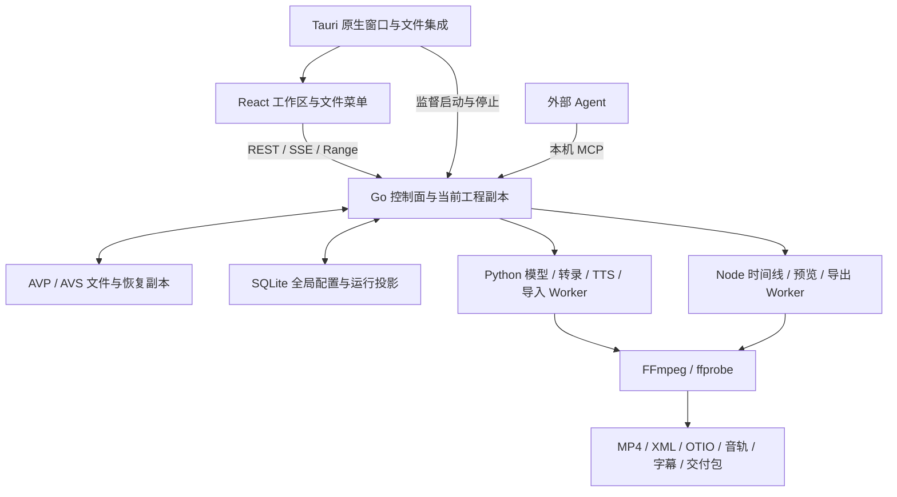

# Video Auto Cut 项目文档

更新：2026-10-20。应用版本 `0.1.1`，以 `agent/vu-skill` 当前源码为准。本文件说明项目目标、现有能力、技术路线、运行方式和开发沿革；当前执行事项只维护在[计划文档](计划文档.md)。请求字段见[接口文档](接口文档.md)，模块与实现细节见[架构与功能详解](架构与功能详解.md)，测试命令和证据边界见[测试维护说明](../scripts/TESTING.md)。

<a id="purpose"></a>
## 1. 项目目的与定位

VAC 是面向游戏录屏、教程、访谈和其他视频素材的 Agent 视频加工工作站。用户打开一个工程，导入视频、音频、图片、字幕、文稿及脚本，选择手写或 Agent 编排，预览并修改结果，最后导出 MP4 或交给剪辑软件精修的文件包。

项目将粗剪、内容理解、解说、配音、字幕和交付连接成可追溯流程。Agent 负责理解 Skill 与提出编排；Go 控制面管理工程、运行、工具边界、版本、预算与发布；Python/Node/FFmpeg 执行媒体和模型任务；用户可以通过可见窗口随时编辑、停止、定稿及查看操作记录。

当前以 Windows Tauri 桌面端为完整产品，浏览器用于开发预览。VAC 提供面向本产品的时间线、片段和声音编辑能力，精细调色、复杂特效及通用剪辑仍通过 Premiere 等软件完成。生成 XML/OTIO 不等于已经在目标软件中验收；FCPXML 尚未实现。

<a id="current"></a>
## 2. 当前产品事实

| 范围 | 已有能力与实际边界 |
|---|---|
| 单工程工作区 | 首页新建、打开、最近及恢复；一个窗口一个 `.avp`，全工作区围绕当前工程 |
| 工程文件 | UTF-8 JSON，格式版本 1；原子保存、独立另存为、30 秒恢复副本、缺失素材占位及重新定位 |
| 资源管理 | 六类资源、名称搜索和类型筛选、源媒体/代理预览、播放控制、入出点、备注及元信息 |
| 脚本 | `.avs` 完整文档、工程内副本、特殊语法、分段和素材绑定、配音/字幕设置、显式导出 |
| Agent | 外部 MCP 和内置 API Agent；原生 Skill、本地说明包导入、版本/摘要锁定、工具循环和预算 |
| 媒体流程 | 受控录屏导入/探测/选轨/分段、词级转录接口、变化抽帧、证据摘要、编排与局部修改 |
| 声音与字幕 | SAPI/StepFun TTS、试听与不可变声音模板、逐段配置、EQ/偏移、混音、SRT、ASS v1/v2 及样式编辑 |
| 预览与交付 | 源媒体预览、独立 MP4 预览任务、脚本成片、XML/OTIO/音轨/字幕/媒体包、同版产物与哈希校验 |
| 历史与诊断 | 项目资源撤销/重做、运行编辑节点、历史预览、取消与恢复、追加式 Agent 日志、REST/SSE 状态 |
| 桌面集成 | 原生文件选择、`.avp` 启动参数、官方单实例转交、剪贴板、后台监督、托盘、签名更新器 |

可见窗口中的鼠标、键盘和窗口自动化操作统一使用最高应用权限的人工身份，不需要人工 Token、Cookie、解锁凭证或授权票据。切页、隐藏和超时不会降低窗口身份。MCP 使用 Agent 身份，Worker 保留内部 Bearer、角色、租约和执行身份；这三种入口的职责不同。

导入当前工程的资源直接供该工程 Agent 使用。外发模型、转录与云配音的配置和调用许可集中在全局服务商/处理预设设置，工程文件不保存服务商密钥。窗口身份规则不改变操作系统权限，也不允许通过 MCP 伪装成人工或读取其他工程资源。

<a id="workflow"></a>
## 3. 使用流程

1. 在首页新建工程，填写名称和保存位置，或打开现有 `.avp`。流程、Skill、预设和预算在发起任务时选择。
2. 通过文件菜单导入素材。已有视频/音频绑定的 `.avs` 需要选择当前资源、本地文件，或仅导入脚本并保留待关联项。
3. 在资源页预览、设置入出点和备注；在脚本工作台编辑正文、旁白、绑定与声音。保存工程不会修改原始素材或原 `.avs`。
4. 按内容选择轻量流程或画面流程，再选择外部 MCP / 内置 API Agent。手写与 Agent 生成脚本是另一个独立选择维度。
5. 检查编排和实际媒体证据，按运行工具要求定稿。生成成片后可按片段、成片时间点或完整片段区间提出修改，重新定稿并渲染。
6. 在运行/交付页预览和下载同版结果。生成结果只有显式导入后才成为资源栏素材。需要精修时导入交付 XML/OTIO，并核对音轨、字幕、切点和重链接。
7. 保存或另存工程；切换前处理未保存内容。存在任务时确认停止并等待退出，取消或保存失败留在当前工程。

| 流程 | 输入和适用内容 | 主要步骤 |
|---|---|---|
| 轻量 `lightweight` | 口播、教程、访谈等语言信息较可靠的素材 | 可用词级转录 → video-use 编排 → 定稿 → FFmpeg 成片/可选 Premiere 包 |
| 画面 `visual_heavy` | 游戏、复杂画面、不宜强制转写的录屏 | 变化抽帧和覆盖采样 → 有证据的大意 → 用户脚本/Agent 编排 → 定稿和交付 |
| 自定义 `custom` | 显式选择的现有 Skill/工具组合 | 遵守相同工程归属、工具、预算、定稿及交付规则 |

外部 MCP Agent 自带模型，不需要 VAC 的推理 Key 才能连接；调用 VAC 的转录或云配音仍需要相应服务配置。缺依赖要明确报告，不自动下载模型、改用云端或切换项目流程。

<a id="architecture"></a>
## 4. 总体架构与技术栈



| 层 | 技术及来源 | 职责 |
|---|---|---|
| 控制面 | Go `1.26.1`，net/http，modernc SQLite，官方 MCP Go SDK；版本见 [go.mod](../control-plane/go.mod) | 唯一业务服务层、事务、运行和文件归属、工具执行与发布 |
| 前端 | React 19、TypeScript、Vite 7、Ant Design 5、TanStack Query；见 [package.json](../webui/package.json) | 五工作区、菜单、表单/草稿、播放器、查询和事件失效 |
| 桌面 | Tauri 2/Rust，WebView2；[锁定依赖](../desktop/Cargo.toml)、[工具链](../desktop/rust-toolchain.toml) | 窗口、文件/剪贴板、单实例、后台进程、下载与更新 |
| Python | Python 3.11+ 与 `vac_worker`；可选依赖显式准备 | 媒体导入、模型协议、转录、声音和内容阶段 |
| Node | Node ≥22.12，timeline-cli、export-worker | 时间线规范化、格式适配、预览、ASS、脚本渲染和任务提交 |
| 媒体工具 | 已安装 FFmpeg/ffprobe，字体、Windows SAPI；云端能力按配置 | 编码、抽帧、探测、字幕、音频与实际文件生成 |

已保存工程以 `.avp` 为依据；Go 管当前工作副本；SQLite 保存当前工程可编辑投影、运行索引、恢复与全局配置。EDL 是媒体编排与交付契约，不能把它、SQLite 或旧 `project.json` 当成第二套工程保存入口。

<a id="layout"></a>
## 5. 源码与数据目录

| 目录 | 内容 |
|---|---|
| `control-plane/` | HTTP/MCP、service、store、迁移、工程模型、Skill 与媒体校验 |
| `webui/src/` | App、ProjectWorkspaceProvider、工作区、组件、SDK 与类型 |
| `desktop/` | Rust 启动、运行监督、平台功能、Tauri 配置和资源清单 |
| `workers/python/vac_worker/` | 普通阶段、服务商请求、脚本/Skill 桥及 ingest 执行隔离 |
| `workers/node/timeline-cli/` | 渲染/格式内核、共享协议使用方和固定媒体样本 |
| `workers/node/export-worker/` | export/preview/delivery_variant MCP Worker |
| `contracts/` | 版本化类型、固定规格、跨语言哈希样本和 ASS 样式实现 |
| `skills/` | VAC Skill 入口、固定上游原件、许可证及运行时工具说明 |
| `scripts/` | 启停、构建、测试治理、验收入口和文档检查 |
| `docs/` | 四份主文档、机器接口索引及少量仍有用途的验收模板 |
| `test-support/legacy/` | 本地源码恢复副本、旧独立入口及本轮文档原文恢复包；不作为日常说明入口 |

当前开发工作树为 `E:/AI/Video Auto Cut/.run-data/worktrees/codex-skill-harness`，分支 `agent/vu-skill`。原根目录和另四个旧工作树保留旧源码/未提交内容，并处于 detached HEAD；不要将它们的程序或测试结果当作当前工作树结果。

业务数据默认位于 `%LOCALAPPDATA%/io.kiriukazurei.video-auto-cut/data/`，也可显式配置独立位置。原始录像与工程保存位置由用户选择。测试输出只进入 `.run-data/tests/<完整版本号>/`，不将正式业务数据、原件或签名密钥放入该目录。

<a id="running"></a>
## 6. 开发、运行与构建

先显式准备 Go、Node/Python 依赖、FFmpeg/ffprobe、Rust/MSVC 和 WebView2。运行程序不负责下载模型。Windows 使用已安装 PowerShell 7 和 UTF-8；实际工具版本由锁文件和构建清单约束。

从所选源码根目录启动/停止本机业务监督器，数据目录必须独立且不在测试根内：

```powershell
pwsh -File scripts/Start-VideoAutoCut.ps1 -DataDirectory 'E:/VideoAutoCutData' -DevelopmentBuild
pwsh -File scripts/Stop-VideoAutoCut.ps1 -DataDirectory 'E:/VideoAutoCutData'
```

`DevelopmentBuild` 显式使用本地 Go 和缓存。预构建运行使用匹配的控制面可执行文件及 `.runtime.json`，同时配对前端、Worker、contracts 和 Skill 资源。单个二进制或旧桌面包不能代表完整当前应用。配置示例见 [desktop.example.json](../desktop/desktop.example.json) 和 [configs](../configs)。

前端开发在 `webui/` 运行 Vite；浏览器仅提供开发预览。桌面使用 `desktop/` 的锁定工具链和配置。生产构建入口为：

```powershell
pwsh -File scripts/Build-TauriDesktop.ps1
pwsh -File scripts/Build-TauriDesktop.ps1 -Installer
```

正式打包要求完整同版资源、预装运行工具和明确的更新签名配置。安装器和公开更新源的验收尚未随 AVP 开发构建完成；本轮文档整理不会生成或发布发行包。测试、类型检查和媒体验证命令统一见 [TESTING.md](../scripts/TESTING.md)。

<a id="history"></a>
## 7. 开发沿革与可追溯事实

| 时间 | 形成的能力或决策 | 仍适用的结论 |
|---|---|---|
| 2026-09 下旬 | Go 服务/SQLite/队列、EDL/时间线、文件交付与 WebUI/MCP 分层 | 业务状态不放在 MCP 或前端；事务和文件发布分别校验 |
| 2026-09-30～10-02 | 视觉/解说、固定修订流程、预设、录屏 ingest、执行隔离与恢复 | Agent 提案不等于人工质量；输入、执行身份、租约与证据绑定 |
| 2026-10-02～10-03 | 当时的真实 OpenAI 调用、Premiere 导入/播放/编辑、媒体迁移重链接与视听效果获用户确认 | 仅覆盖当时交付和素材；Anthropic/Gemini 真实调用按用户要求排除，不能据此验收当前 AVP 候选 |
| 2026-10-05～10-09 | MP4、独立预览任务、ASS v1/v2/编辑器、TTS、Tauri 和更新器 | 规格/样式不可变、独立媒体复核、历史产物不可覆盖 |
| 2026-10-09～10-13 | 部分真实 ASS/StepAudio 样本获确认；历史本地签名升级有记录 | 只覆盖当时样本/候选；不能写成当前 AVP、全部模型或公开发行已验收 |
| 2026-10-16～10-18 | 自动模式、脚本工作台、重定向防护、事务重核与开发分支整合 | CR03 键盘焦点问题仍待处理；旧授权及项目列表流程后来被 AVP 替代 |
| 2026-10-19 | Skill Harness、双流程/双 Agent、操作日志、局部改稿及不可变历史 | Skill 是说明；Go 执行工具与预算；真实外部模型质量仍另验 |
| 2026-10-20 | AVP/AVS、窗口免凭证、集中服务许可、菜单/资源重构及 22 项可见桌面验证 | 原始素材引用、工程恢复和隔离成为当前契约，无旧项目迁移入口 |
| 2026-10-20 | 有效源码提交 `7dda64d`，分支收口提交 `6242cf7` 并推送 | 本地/远程 agent 系列仅 main 与 vu-skill；main 两端原位，旧工作树源码保留 |
| 2026-10-20 | 本轮文档整合完成 | 删除已迁移的 98 份说明和 3 份过期源码索引，四份主文档收口；文档/契约、样式、MCP 定向回归及保留边界核验通过 |

最近一次确定源码回归为 `7dda64d`：Go 全包、前端 92、Python 159、Timeline 54、Exporter 53 及类型/样式/静态契约检查通过。AVP 可见桌面 22/22 是此前相同功能源码的实际窗口验证。二者均不等于人工观感、真实外部模型、Premiere/Resolve 或新安装包验收。完整命令、失败后复验和证据位置只维护在测试说明中。

<a id="documentation"></a>
## 8. 文档维护与保留例外

主说明只有本文件、计划文档、接口文档、架构与功能详解。项目事实和开发沿革写本文件；正在做及下一步只写计划；接口字段写接口；实现机制写详解，避免再创建按日期复制的进度与方案。

额外保留：根 `README.md` 作为导航；`AGENTS.md` 作为仓库操作约束；`scripts/TESTING.md` 作为现有测试权威入口；`frontend-api-inventory.json`、contracts 类型/规格/fixture 及待验模板作为机器契约；运行时 Skill、嵌入说明和上游许可证/原件作为产品资源。这些文件有独立职责，不另写重复项目总说明。模板中的 pending/not_run/not_checked 保持其真实含义，不能当成已经通过的结果。

本轮同时核对文件系统编辑时间、Git 最后修改及正文。检出/批量加历史提示可能刷新时间，不因此认可过期内容。旧文档在迁移有效内容后退出活动目录；Git 历史和本地压缩恢复副本仅用于追溯，不保留旧计划为现行入口。后续内容冲突以当前源码注册、实际验证和这四份文档的一致更新为准。

本次原有 110 份说明全部盘点：文件系统时间超过 7 天为 0，Git 最后修改超过 7 天为 22；对其余重复说明也作内容合并。精确移除 98 份说明及 3 份过期源码哈希索引，合计 1,392,486 字节，其中 47 项原已跟踪、54 项为原本本地说明。最终保留四份主文档和 12 份有独立职责的说明（导航/指引/测试 3 份，运行时及上游原件 9 份）。

原有说明及废弃索引约 1.52 MB，现活动说明约 0.32 MB。113 项原文压缩为 712,575 字节的本地恢复包，逐项校验 SHA-256，审阅与迁移清单保存在 `test-support/legacy/document-consolidation-20261020/`；该恢复资料不进入 Git，也不计作磁盘净释放。10-13 旧清单的 47 个测试路径仍保留，后续处理见计划文档 ARCH01。

README、仓库指引、测试说明、检查器、样式与源码注释均改到新入口；桌面构建复制四份主文档。语法 Skill 目录/嵌入副本同步修正旧可见确认和配音说明，包版本为 1.0.2。未改业务接口、模型/运行权限或媒体流程，未删除产品数据、测试源码、固定样本和上游许可证。
