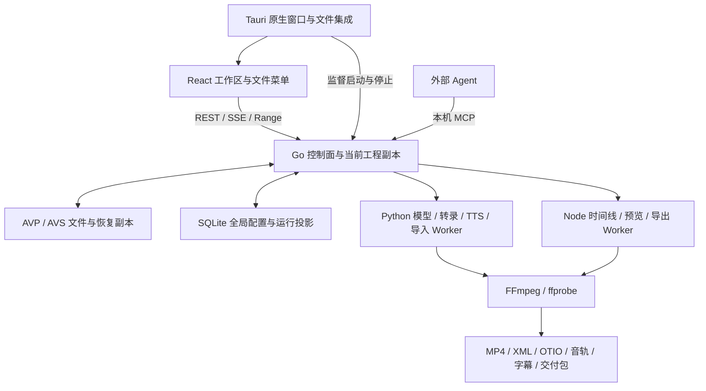

# Video Auto Cut 项目文档

更新：2026-11-08。应用源码版本 `0.5.1`，当前开发分支 `codex/integrate-remote-20261029`，工作区 `E:/AI/Video Auto Cut/.run-data/worktrees/integrate-remote-20261029`。本版本纳入 Shotcraft 镜头卡、脚本选卡和绘制 Skill 编译流程。源码、安装包和真实模型验收状态分别见[计划文档](计划文档.md)。

本文说明项目定位、产品组织、技术架构、运行和开发沿革。模块功能与Agent开发约束见[功能文档](功能文档.md)，全部说明的职责见[文档索引](文档索引.md)。当前工作只维护在[计划文档](计划文档.md)，验证证据只维护在[测试维护说明](../scripts/TESTING.md)。

<a id="current"></a>
## 1. 项目定位与当前基线

2026-11-05 SCRIPT-V3：按用户要求先用本地标签`checkpoint/0.4.0-before-script-syntax`保留d373947基线，随后实施共享指令注册表、时间/诊断、缩放/透明度/定时字幕和工作台补全。参数直接生效，作者文本与创作描述分别保存；旧语法兼容，AVS不升级。本轮不自动推送远程或更新安装器，实际测试与未验边界见TESTING。

2026-11-04 VERSION040：代码轨、复审修复、测试整理及0.4.0版本元数据以ff636ca提交并推送当前远程分支，远程HEAD已核对一致。前端142项、类型/样式/文档和MCP8种协议连接通过，原MCP版本不一致关闭；其余历史全量失败与真实模型/新原生包待验边界保留。公开安装版仍0.3.4，本次未创建Release或修改业务工程。

2026-11-04 CODE-REVIEW：再次审查代码轨并修复分段声音/迁移转场、缓存元数据、新实例任务归属、颜色稳定及脚本文字换算问题。已有测试按职责整理，统一webui完整入口，custom检查命名隔离并记录实际源码目录；未发布、未更新安装版。逐项证据与仍未通过/未验范围只维护在TESTING，当前进度见计划文档。

2026-11-04未发布开发增量（CODE-TRACK）：可编辑源码画面独立进入代码轨，旧工程自动迁移且打开不写回原文件；右侧脚本工作台按实例维护描述和参数，支持多选、局部Agent生成、一条变多条、波纹、冲突结果保留及整次撤销。Motion Canvas 3.17.2与既有HTML/Remotion共用帧合成和音频。实现和本轮定向自动验收完成；全量Go仍有原版本/Windows环境失败，真实模型、原生包和人工观感未验，具体范围见计划及TESTING。

2026-11-04未发布开发增量（PLAY-OPT01）：简单时间线源视频/独立音轨直播放及下一片段预加载；复杂内容按播放头附近分段合成，复用常驻源码宿主与局部缓存，完整同版缓存直接接管。只读请求不再复制全部撤销历史；隐藏与范围外轨不触发节目内容/字体依赖。源码代理最高960宽、8fps时间采样，输出保留序列帧率与音频时钟，精确静帧和正式导出不降采样。最新候选同一业务工程3381ms可播（原145830ms），一分钟正常速度/切点/寻址通过；复杂源码连续16秒跨8段播放用16.083秒，GPU画面/复用/退出释放通过。前端与定向媒体/Go/API检查通过，扩展service全包因目录访问、长PCM样本磁盘不足及超时仍失败，不称全量通过；具体证据见TESTING；安装版仍为原0.3.4，以下原0.3.4冷缓存等待为优化前基线。未实现硬件编码或完整实时GPU纹理管线。

2026-11-03用户确认：0.3.3定位为**生产试用版**，进入真实项目试用与问题收集。已验证的执行流程可用于实际项目，真实模型效果、规模与性能及人工观感继续按实际证据记录；该定位不等于全项目完工。

2026-11-03生产试用反馈：0.3.4同一业务工程的真实播放已复验，冷缓存约2分26秒后可播、跨进程热缓存约10秒，均实际推进播放时钟且未改AVP。首帧优先/GPU单帧不能消除整段CPU MP4生成等待，首次可播放性能问题仍未修复；此前GPU与安装验收不代表这一等待成本可接受。具体证据与下一步见计划及测试维护说明。

2026-11-03开发增量：按两步策略完成第一步，并提前纳入GPU合成。节目预览使用常驻绘制环境、源/合成帧LRU和播放头附近预取，WebGL2处理基础效果，CPU回退与导出共用有效片段计划；已有同版成片直接取帧。真实RTX3070/D3D11、1080p一分钟测试构图、原生画面可见及退出释放已验证；冷编译开销仍在，连续音画播放/硬件解码/代理质量留第二步。加载遮罩遮挡与进程命名空间问题已修并保留红灯。0.3.4已发行并通过安装版生产更新器升级，业务工程未修改；范围和证据见计划、功能文档及测试维护说明，人工手感仍待试用。

2026-11-02新增原生证据：新版调试桌面的脚本保存→外部MCP生成→局部修改→导出/保存重开已通过，包含未选片段与人工编辑保留。随后实现数据目录固定MCP入口；后台和完整桌面重启保持同一URL，回归客户端自动重新初始化、端口占用与恢复也通过。未调用真实服务商模型，未验证所有第三方Agent重连实现，不判整体完成。详细范围见测试说明。

VAC是以Agent自主剪辑为目标的视频工程工作站。用户保存创作要求、导入素材或创建程序化画面，Agent理解内容、编排、配音、剪辑和导出；用户可随时查看真实时间线、编辑、取消，并直接检查成片。适用于游戏录屏、教程、访谈、口播和代码动画，不承诺代替通用剪辑软件的全部调色与复杂特效。

Windows Tauri桌面是完整产品入口，浏览器用于开发预览。一个窗口围绕一个`.avp`当前工程；保存原始素材引用和编辑内容，不修改媒体原件。已保存工程以AVP为依据，当前写AVP3、AVS2并兼容读取旧版本。

| 当前事实 | 说明与边界 |
|---|---|
| 自主执行 | 内部API和外部MCP Agent共用工具；可读取脚本、编辑计划/配音/时间线、纠错与恢复所属任务，不再要求逐轮人工定稿 |
| 页面组织 | 资源、独立脚本、编辑、绘制、导出，以及TTS和设置；无独立审核/验收页或验收选项，直接在编辑页看成片 |
| 脚本保存 | 无素材也可新建；多脚本选择、保存、AVP重开恢复；复制Agent任务前保存当前修订，失败保留输入并阻止旧任务交接 |
| 编辑与绘制 | 多序列/多轨、真实源流、常用效果和标记；HTML/GSAP与React/Remotion构图可渲后入轨或保留源参与合成 |
| 输出 | MP4、Premiere XML/OTIO及媒体/音轨/字幕文件包；历史与当前内容版本分别管理 |
| 已发布基线 | 2026-11-03发布[v0.3.4](https://github.com/KiriuKazurei/Video-A-Cut/releases/tag/v0.3.4)，标签c19099c；D:/Applications/VAC原0.3.3通过生产更新器实际升级、自动重启并确认已最新 |
| 当前验证 | 脚本增量前端135项、浏览器13项、真实HTTP/MCP定向通过；工程检查、真实运行、模型质量与人工体验分别记录 |
| 尚未关闭 | 第三方Agent实际重连兼容性、可编辑源共享终渲性能、同等规模自主流程/真实模型质量复验等，见计划与问题清单 |

当前0.3.4已发布，生产更新器完整下载、验签、实际安装和自动重启通过；公开清单附件命名404已修正，失败与后续通过记录见计划及测试说明。回退与人工观感未验。历史模型、桌面、Premiere和成片的人工认可只覆盖当时素材与候选，不自动继承给本工作副本。

<a id="workflow"></a>
## 2. 用户工作路径

1. 新建或打开AVP，确定保存位置；导入视频、音频、图片、字幕、文稿或脚本，也可从空工程开始绘制。
2. 在独立脚本工作区新建并保存创作要求。引用素材、片段或标记时选择确切对象，必要时编辑分段旁白。
3. 选择外部MCP Agent或已配置的内部模型。外部Agent复制任务后读取最新脚本；内部模型先保存再生成。缺依赖明确报告，不静默下载、切云或更换模型。
4. Agent按Skill读取证据、编排并直接执行编辑；可用lightweight、visual_heavy或自定义组合，也可使用绘制管线。计划和修订由工具绑定，不要求人工逐步确认。
5. 在编辑页查看节目、试听、修改时间线或比较独立Agent轨组。绘制源保留可编辑性，渲后视频也可参与混剪。
6. 导出MP4或Premiere交付包；需要外部精修时实际核对XML/OTIO、音轨、字幕、切点及重链接。机器质量提示不代替人工观感。
7. 保存或另存工程，切换和退出时处理未保存内容与在途任务。迁移时保留外部媒体依赖。

各功能模块的职责、不变量、现有复用入口及修改限制统一见[功能文档](功能文档.md)，Agent开发前须核对所涉模块，避免重复建设和无关扩展。

<a id="architecture"></a>
## 3. 总体架构与技术栈



| 层 | 技术及来源 | 职责 |
|---|---|---|
| 控制面 | Go `1.26.1`，net/http，modernc SQLite，官方 MCP Go SDK；版本见 [go.mod](../control-plane/go.mod) | 唯一业务服务层、事务、运行和文件归属、工具执行与发布 |
| 前端 | React 19、TypeScript、Vite 7、Ant Design 5、TanStack Query；见 [package.json](../webui/package.json) | 资源/脚本/编辑/绘制/导出/TTS/设置；「绘制」是少开顶栏分页的显式例外。菜单、表单/草稿、播放器、查询和事件失效 |
| 桌面 | Tauri 2/Rust，WebView2；[锁定依赖](../desktop/Cargo.toml)、[工具链](../desktop/rust-toolchain.toml) | 窗口、文件/剪贴板、单实例、后台进程、下载与更新 |
| Python | Python 3.11+ 与 `vac_worker`；可选依赖显式准备 | 媒体导入、模型协议、转录、声音和内容阶段 |
| Node | Node ≥22.12，timeline-cli、export-worker | 时间线规范化、格式适配、预览、ASS、脚本渲染和任务提交 |
| 媒体工具 | 已安装 FFmpeg/ffprobe，字体、Windows SAPI；云端能力按配置 | 编码、抽帧、探测、字幕、音频与实际文件生成 |

已保存工程以 `.avp` 为依据；Go 管当前工作副本；SQLite 保存当前工程可编辑投影、运行索引、恢复与全局配置。EDL 是媒体编排与交付契约，不能把它、SQLite 或旧 `project.json` 当成第二套工程保存入口。


<a id="layout"></a>
## 4. 源码与数据目录

| 目录 | 职责 |
|---|---|
| `control-plane/` | Go HTTP/MCP、service、store、迁移、工程模型、Skill和媒体校验 |
| `webui/src/` | React工作区、工程Provider、SDK、组件和类型 |
| `desktop/` | Tauri启动、后台监督、原生文件/剪贴板、单实例和更新 |
| `workers/python/vac_worker/` | 模型、转录、TTS、导入和运行执行 |
| `workers/node/timeline-cli/` | 多轨/绘制合成、格式内核、字幕、预览和固定媒体 |
| `workers/node/export-worker/` | 导出/预览/派生交付Worker |
| `contracts/` | 跨语言协议、固定规格、哈希样本及字幕样式实现 |
| `skills/` | 运行时Skill、工具说明、固定上游原件和许可证 |
| `scripts/` | 启停、构建、测试治理和文档检查 |
| `docs/` | 五份主文档、文档索引、接口清单及独立开发交接 |
| `test-support/legacy/` | 旧入口、源码/文档恢复副本，仅供追溯，不作为当前使用入口 |

正式数据默认在`%LOCALAPPDATA%/io.kiriukazurei.video-auto-cut/data/`，也可指定独立目录；工程和媒体位置由用户选择。原始录像、工程、签名密钥及正常开发依赖不放测试目录。测试输出通过统一入口管理，具体约束见TESTING。

<a id="running"></a>
## 5. 开发、运行与构建

Windows使用已安装PowerShell 7及UTF-8，保留profile。先按锁文件显式准备Go、Node、Python、FFmpeg/ffprobe、Rust/MSVC和WebView2；运行程序不会自动下载模型。以下命令在**选定源码根**执行，不能在旧工作树运行后当作新候选。

```powershell
pwsh -File scripts/Start-VideoAutoCut.ps1 -DataDirectory 'E:/VideoAutoCutData' -DevelopmentBuild
pwsh -File scripts/Stop-VideoAutoCut.ps1 -DataDirectory 'E:/VideoAutoCutData'
```

这是本机业务监督器入口；Vite浏览器预览不能替代桌面窗口。桌面工具链、启动及打包以`desktop/`配置和构建脚本为准，配置示例见[desktop.example.json](../desktop/desktop.example.json)。预构建程序须配对控制面、runtime清单、前端、Worker、contracts和Skill；单个旧二进制不代表当前完整应用。

```powershell
pwsh -File scripts/Build-TauriDesktop.ps1
pwsh -File scripts/Build-TauriDesktop.ps1 -Installer
```

打包需同版完整资源和明确签名配置；运行这些命令不会自动获得发布授权。测试入口、依赖和输出规则只维护于[TESTING.md](../scripts/TESTING.md)。本轮文档整理未启动桌面、调用模型、构建安装器或发布。

<a id="history"></a>
## 6. 开发沿革与历史证据

下表记录能力如何形成，不表示每个历史实现状态仍是当前状态；例如DRAW01空壳、右坞脚本和人工定稿规则已经被后续实现替代。

| 时间 | 形成的能力或决策 | 仍适用的结论 |
|---|---|---|
| 2026-09 下旬 | Go 服务/SQLite/队列、EDL/时间线、文件交付与 WebUI/MCP 分层 | 业务状态不放在 MCP 或前端；事务和文件发布分别校验 |
| 2026-09-30～10-02 | 视觉/解说、固定修订流程、预设、录屏 ingest、执行隔离与恢复 | Agent 提案不等于人工质量；输入、执行身份、租约与证据绑定 |
| 2026-10-02～10-03 | 当时的真实 OpenAI 调用、Premiere 导入/播放/编辑、媒体迁移重链接与视听效果获用户确认 | 仅覆盖当时交付和素材；Anthropic/Gemini 真实调用按用户要求排除，不能据此验收当前 AVP 候选 |
| 2026-10-05～10-09 | MP4、独立预览任务、ASS v1/v2/编辑器、TTS、Tauri 和更新器 | 规格/样式不可变、独立媒体复核、历史产物不可覆盖 |
| 2026-10-09～10-13 | 部分真实 ASS/StepAudio 样本获确认；历史本地签名升级有记录 | 只覆盖当时样本/候选；不能写成当前 AVP、全部模型或公开发行已验收 |
| 2026-10-16～10-18 | 自动模式、脚本工作台、重定向防护、事务重核与开发分支整合 | CR03 后于 0.2.1 修复并补足键盘回归；旧授权及项目列表流程后来被 AVP 替代 |
| 2026-10-19 | Skill Harness、双流程/双 Agent、操作日志、局部改稿及不可变历史 | Skill 是说明；Go 执行工具与预算；真实外部模型质量仍另验 |
| 2026-10-20 | AVP/AVS、窗口免凭证、集中服务许可、菜单/资源重构及 22 项可见桌面验证 | 原始素材引用、工程恢复和隔离成为当前契约，无旧项目迁移入口 |
| 2026-10-20 | 有效源码提交 `7dda64d`，分支收口提交 `6242cf7` 并推送 | 本地/远程 agent 系列仅 main 与 vu-skill；main 两端原位，旧工作树源码保留 |
| 2026-10-20 | 本轮文档整合完成 | 删除已迁移的 98 份说明和 3 份过期源码索引，四份主文档收口；文档/契约、样式、MCP 定向回归及保留边界核验通过 |
| 2026-10-20 | 0.2.1：修复 CR03，接入本地 ASR、MCP 设置与原生复制；功能提交 cadd51a 已推送 agent/vu-skill | CPU/int8 真实本地识别、配置重载、动态地址和完整桌面回归通过；模型不下载、不外发、不云回退 |
| 2026-10-21 | 标题栏与背景统一，工程名和未保存标记移到程序名右侧，后台状态移到底栏 | 提交前工作副本的前端 93 项、Rust 5 项及真实桌面 31 项通过；人工观感待确认，本次归档为本地 Git 提交，未推送远程 |
| 2026-10-21 | 以 26e17fd 为基线实现统一多轨编辑、多序列、常用效果、共用节目/导出合成及带类型标记引用；完整 Skill 成片并行入轨，结构化 Agent 编辑显示实际效果 | AVP/AVS 写 v2、读 v1；开发版本仍为 0.2.1。源码和文档保留为本地未提交工作副本，未推送。当前工程、原生桌面和人工验收分别见测试说明与计划，不改写原用户 AVP |
| 2026-10-22 | 将多轨编辑器及标题栏实现整合为 0.2.2，同步 Tauri/Cargo/npm/MCP 版本与锁文件，轮换旧测试生成物并推送 agent/vu-skill（代码提交 c5fccf4） | 版本/元数据、前端 96、类型/样式/构建、MCP 及文档契约通过；0.2.1 完整回归单列，0.2.2 未重跑原生/模型/人工验收；agent/main 不动，原 AVP 与业务数据不进提交 |
| 2026-10-23 | 0.2.4：时间线音量谱与视频缩略图、Premiere 式右坞脚本工作台（可调宽、引用到脚本）、节目监视与工具栏/播放头等编辑 UX 打磨；推送 agent/timeline-audio-viz | 本地 webui tsc/build、相关单元与样式检查通过；未重跑完整 Go/Python/原生桌面或外部模型验收；agent/main 不动 |
| 2026-10-23 | DRAW01 Phase 1：顶栏「绘制」、四区空壳、深链，以及 video-use `0.1.0-vac.5` 与三个绘制说明包 | 衔接动作与沙箱仍为「方案接线中」；不升营销版本；Gate 未开。详见计划文档 §4.1 |

| 2026-10-25～27 | 双引擎绘制、图片引用、AVP3源构图入轨及共享终渲；真实模型创作反馈修复 | 工程/媒体/原生回归分别留证，源构图性能和发行不由功能接通自动关闭 |
| 2026-10-28～29 | 基础黑屏/静音检查、默认本地预设、诊断报告与远程整合 | 检查警告不阻止交付；默认builtin不等于真实模型；在线安装/AI修改仍后置 |
| 2026-10-29 | v0.3.2公开发行，Windows x64 NSIS、签名与latest.json | 旧桌面完成正式源下载验签；本轮未执行替换安装或回退，后续增量未发布 |
| 2026-10-30 | 独立脚本、模型直发、Agent交接与MCP安装复制；60秒Remotion音乐动画实测 | 1800帧、1080p、30fps及音轨核验，源码/分镜保留；人工观感未代签，源逐帧性能未修复 |
| 2026-11-01 | Agent自主恢复/计划编辑/配音/诊断；移除验收UI，脚本新建保存与Agent读取 | 最新增量自动验证通过；新候选桌面全流程、真实模型质量与发行仍分开待验 |

历史数据迁移、清理释放量、旧失败和各套件结果仅作当时记录，详见测试维护说明及Git/本地恢复副本；不从旧数字推断当前磁盘、进程或运行状态。旧报告命令不构成再次清理、调用服务或推送授权。

<a id="documentation"></a>
## 7. 文档维护

五份主文档各管一件事：本文件管项目事实与沿革，[功能文档](功能文档.md)管模块职责、功能边界及Agent开发约束，[计划文档](计划文档.md)管当前执行与下一步，[接口文档](接口文档.md)管调用合同，[架构与功能详解](架构与功能详解.md)管实现机制。独立说明职责与当前/历史规则见[文档索引](文档索引.md)。

功能改变时同步更新入口、功能说明、机制和接口；测试结果写现有TESTING，不新增按日期复制的项目状态。后置设计明确标注未实现；历史结果不能写成当前通过。保持机器索引、contracts、Skill运行说明和上游原件的独立职责，不把它们当重复文档删除。
