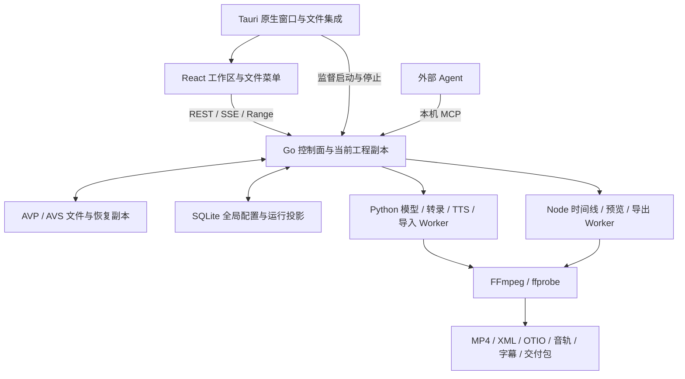

# Video Auto Cut 项目文档

更新：2026-10-29。应用版本 `0.3.2`，本轮整合源码为 `codex/integrate-remote-20261029`（独立工作树 integrate-remote-20261029）。本文件说明项目目标、现有能力、技术路线、运行方式和开发沿革；当前执行事项只维护在[计划文档](计划文档.md)。请求字段见[接口文档](接口文档.md)，模块与实现细节见[架构与功能详解](架构与功能详解.md)，测试命令和证据边界见[测试维护说明](../scripts/TESTING.md)。

2026-10-29 后续范围：统一诊断与脱敏JSON报告已实现并自动验收（本机依赖、Worker、模型配置，外部模型未调用）；在线 Skill 安装/更新只预留 disabled/501 接口。用户确认 FCPXML 暂不内置、以后经 exporter Plugin 在线安装；依赖/模型部署向导交其他 Agent、AI画面修改仅保留接口并等待用户具备图像编辑模型后再授权实施，两者仅交付 docs/development 下开发文档。当前改动仍为0.3.2未发布工作副本，实际验证状态见计划。

2026-10-29 发行：GitHub Release [v0.3.2](https://github.com/KiriuKazurei/Video-A-Cut/releases/tag/v0.3.2) 已公开，标签对应 f004655，提供签名 Windows x64 NSIS 安装器、.sig 和 latest.json，设为 latest。0.2.3 桌面已从正式源完整下载 74908962 字节并验签成功，达到可安装状态；本轮未执行安装替换或回退。详情及证据见测试说明。

2026-10-29 远程整合：以 origin/agent/timeline-audio-viz@98ba0e0 为基线，将 origin/agent/vu-skill@8511f2e 的默认本地预设/中文 SAPI 模板和媒体基础检验合入，保留 0.3.2、绘制源、音量分析和导出进度。其他远程分支均已被基线包含。整合在独立分支进行，根目录及原工作树内容、原分支均保留，当时未推送或发行（后续见上述发行记录）。前端128、媒体28、Go全包编译及定向、文档契约通过；原生安装升级与人工体验未验。更新器源码存在，发布前公开源为0.2.3，发布后已为0.3.2，详见架构文档§16。

2026-10-25 阶段一绘制执行增量：基于远程 agent/timeline-audio-viz@a23d138 继续，未改动 agent/main 或原 vu-skill 工作树。AVP v2 增加 draw_compositions；三个绘制包变为可主动选用的可执行策略，video-use adapter 为 0.1.0-vac.6。HyperFrames HTML/GSAP 和 Remotion TSX 接入本地受控渲染；MCP 已实际完成空工程写源码、渲染、查看图片、入轨、分割移动和共享导出。该阶段基础执行链路自动回归完成：Go 18 包（service 首轮发布失败、复验通过）、Python 165、前端 123、Timeline 72、Exporter 53、浏览器 14+7 组及契约检查通过；本轮增量仍在本地，未提交/推送。不继承旧桌面的验收结论。当时未渲源码合成待实现；现由DRAW05完成，安装器和人工观感另验。

2026-10-25 图片绘制增量：图片直接引用当前工程资源 ID，位置、尺寸、位移、帧区间和显示方式保存于构图；两引擎均支持自动图层与源码模式。同一原图可放置多个独立实例。原件只读使用，不修改图片文件；删除/缺失/变更保留引用并阻止误用过期渲染。图片增量已完成自动验收；draw 包为 0.3.0、video-use 为 0.1.0-vac.7。前端 124、Timeline 74、Python 165、浏览器 14+8、受影响 Go 包及契约检查通过；原生和人工体验本轮未验。具体字段见接口及架构文档，证据见测试说明。

2026-10-26 统一绘制实施：默认自动协同与用途预设；双引擎共享帧、AVP3、持续预览及源构图入轨已接通，当前验收进度见计划/测试说明。实现详见[统一绘制框架](架构与功能详解.md#unified-draw-proposal)。

2026-10-27 用户确认大肥鱼测试成片观感通过；模型执行进度/租约、图片引用诊断、JPG原路径解码、模型流与输出预算修复完成。Go六包、前端128、Node21、Python172及增量、Chrome绘制12/设置8和可见Tauri10项通过，另覆盖项目隔离、错误流、草稿/刷新恢复与扩展媒体边界。0.3.1验收时未提交或推送、没有再次调用真实StepFun，原成片及工程保留；修复后的用户手感另验，证据见测试说明。

2026-10-27 REL032：应用升级至0.3.2，统一绘制及上述修复的代码提交 `dff2f5a1d1fc0f7ebd99a0419fca8f43e091a769` 已推送并核对 `origin/agent/timeline-audio-viz`。发布检查及已验收成片保全位置见[测试说明](../scripts/TESTING.md)。

<a id="purpose"></a>
## 1. 项目目的与定位

VAC 是面向游戏录屏、教程、访谈和其他视频素材的 Agent 视频加工工作站。用户打开一个工程，导入视频、音频、图片、字幕、文稿及脚本，选择手写或 Agent 编排，预览并修改结果，最后导出 MP4 或交给剪辑软件精修的文件包。

项目将粗剪、内容理解、解说、配音、字幕和交付连接成可追溯流程。Agent 负责理解 Skill 与提出编排；Go 控制面管理工程、运行、工具边界、版本、预算与发布；Python/Node/FFmpeg 执行媒体和模型任务；用户可以通过可见窗口随时编辑、停止、定稿及查看操作记录。

当前以 Windows Tauri 桌面端为完整产品，浏览器用于开发预览。VAC 提供面向本产品的时间线、片段和声音编辑能力，精细调色、复杂特效及通用剪辑仍通过 Premiere 等软件完成。生成 XML/OTIO 不等于已经在目标软件中验收；FCPXML 尚未实现。

<a id="current"></a>
## 2. 当前产品事实

2026-10-28 QC01：成片基础检查对照源声音检测异常静音，并检查计划内视频区间的异常黑屏。检查结果绑定成片摘要；异常及检查未完成均提示，仍允许交付，人工观感独立验收。

2026-10-28 CFG01：新增启动时补建的默认本地处理预设与中文 SAPI 模板，固定版本绑定，保留用户自定义、修改和归档。已有设置页/TTS 页读取现有接口即可选择、升版与重新绑定。默认 builtin 不提供真实视觉/解说模型；模型配置和实际声音可用性仍需按环境检查，真实听感与桌面验收单列。

| 范围 | 已有能力与实际边界 |
|---|---|
| 单工程工作区 | 首页新建、打开、最近及恢复；一个窗口一个 `.avp`，全工作区围绕当前工程 |
| 工程文件 | UTF-8 JSON，AVP写入格式版本3、AVS保持2；兼容读取旧AVP1/2和AVS1，打开不改原文件；原子保存、独立另存为、30 秒恢复副本、缺失素材占位及重新定位 |
| 资源管理 | 六类资源、名称搜索和类型筛选、源媒体/代理预览、播放控制、入出点、备注及元信息 |
| 脚本 | `.avs` 完整文档、工程内副本、特殊语法、分段和带类型的稳定引用；重名消歧、素材/时间线标记补全、选择性改名同步、显式导出 |
| 统一多轨编辑 | 多序列、默认 3V/3A、源/节目监视器、真实源流展开和链接；拖动/修剪/分割/波纹/撤销、常用效果、标记、轨道范围对照；实现与验收进度单列在计划及测试说明 |
| 统一绘制 | 默认自动协同、用途预设、原生HF/React/公共图层同帧预览；图片/RAW、关键帧、整场景撤销、可编辑源入轨和透明输出 |
| Agent | 外部 MCP 和内置 API Agent；实时 MCP 地址与 JSON/Codex TOML 复制、原生 Skill、本地说明包导入、版本/摘要锁定、工具循环和预算 |
| 媒体流程 | 受控录屏导入/探测/选轨/分段、本地 faster-whisper / 云词级转录、变化抽帧、证据摘要、编排与局部修改 |
| 声音与字幕 | SAPI/StepFun TTS、试听与不可变声音模板、逐段配置、EQ/偏移、混音、SRT、ASS v1/v2 及样式编辑 |
| 预览与交付 | 源媒体预览、独立 MP4 预览任务、脚本成片、XML/OTIO/音轨/字幕/媒体包、同版产物与哈希校验 |
| 历史与诊断 | 项目资源撤销/重做、运行编辑节点、历史预览、取消与恢复、追加式 Agent 日志、REST/SSE 状态 |
| 桌面集成 | 原生文件选择、`.avp` 启动参数、官方单实例转交、剪贴板、后台监督、托盘、签名更新器；标题栏与背景同色，程序名后显示当前工程及未保存标记，后台状态置于底栏 |

可见窗口中的鼠标、键盘和窗口自动化操作统一使用最高应用权限的人工身份，不需要人工 Token、Cookie、解锁凭证或授权票据。切页、隐藏和超时不会降低窗口身份。MCP 使用 Agent 身份，Worker 保留内部 Bearer、角色、租约和执行身份；这三种入口的职责不同。

导入当前工程的资源直接供该工程 Agent 使用。外发模型、转录与云配音的配置和调用许可集中在全局服务商/处理预设设置，工程文件不保存服务商密钥。窗口身份规则不改变操作系统权限，也不允许通过 MCP 伪装成人工或读取其他工程资源。

<a id="workflow"></a>
## 3. 使用流程

1. 在首页新建工程，填写名称和保存位置，或打开现有 `.avp`。流程、Skill、预设和预算在发起任务时选择。
2. 通过文件菜单导入素材。已有视频/音频绑定的 `.avs` 需要选择当前资源、本地文件，或仅导入脚本并保留待关联项。
3. 在资源页预览、设置入出点和备注；进入统一编辑器，把资源拖入当前序列，也可在源监视器选择“加入序列”。右侧调整片段、效果及标记；脚本以 `{@识别名}` 补全并绑定具体对象。保存工程不会修改原始素材或原 `.avs`。
4. 按内容选择轻量流程或画面流程，再选择外部 MCP / 内置 API Agent。手写与 Agent 生成脚本是另一个独立选择维度。
5. 完整成片计划检查编排和媒体证据后定稿，修改计划需重新定稿。结构化 Agent 轨道命令直接显示真实编辑，完成时核验序列修订和内容版本；两者均不代替人工试听与观感。
6. 在运行/交付页预览和下载同版结果。完整 Skill 成功成片自动成为资源，在发起序列帧零建立独立 Agent 视频/音轨组，与人工剪辑并存；默认单独对照。其他生成结果可显式导入。需要精修时核对交付 XML/OTIO、音轨、字幕、切点和重链接。
7. 保存或另存工程；切换前处理未保存内容。存在任务时确认停止并等待退出，取消或保存失败留在当前工程。

| 流程 | 输入和适用内容 | 主要步骤 |
|---|---|---|
| 轻量 `lightweight` | 口播、教程、访谈等语言信息较可靠的素材 | 可用词级转录 → video-use 编排 → 定稿 → FFmpeg 成片/可选 Premiere 包 |
| 画面 `visual_heavy` | 游戏、复杂画面、不宜强制转写的录屏 | 变化抽帧和覆盖采样 → 有证据的大意 → 用户脚本/Agent 编排 → 定稿和交付 |
| 自定义 `custom` | 显式选择的现有 Skill/工具组合 | 遵守相同工程归属、工具、预算、定稿及交付规则 |

上表三条属于已有视频剪辑流程。并列的“绘制”工作区以vac-draw-pipeline为默认Agent入口：自动选择公共图层、HTML/GSAP或React组件，按需要同帧协作；用户调整一个画布、图层集和播放头。支持未渲源快照/跟随入轨、与剪辑轨共同预览/最终一次编码，以及独立视频导出。源码/引擎覆盖放在高级区；细节见[统一绘制框架](架构与功能详解.md#unified-draw-proposal)。

外部 MCP Agent 自带模型，不需要 VAC 的推理 Key 才能连接；调用 VAC 的转录或云配音仍需要相应服务配置。缺依赖要明确报告，不自动下载模型、改用云端或切换项目流程。

<a id="architecture"></a>
## 4. 总体架构与技术栈



| 层 | 技术及来源 | 职责 |
|---|---|---|
| 控制面 | Go `1.26.1`，net/http，modernc SQLite，官方 MCP Go SDK；版本见 [go.mod](../control-plane/go.mod) | 唯一业务服务层、事务、运行和文件归属、工具执行与发布 |
| 前端 | React 19、TypeScript、Vite 7、Ant Design 5、TanStack Query；见 [package.json](../webui/package.json) | 资源/编辑/绘制/导出/TTS/设置；「绘制」是少开顶栏分页的显式例外。菜单、表单/草稿、播放器、查询和事件失效 |
| 桌面 | Tauri 2/Rust，WebView2；[锁定依赖](../desktop/Cargo.toml)、[工具链](../desktop/rust-toolchain.toml) | 窗口、文件/剪贴板、单实例、后台进程、下载与更新 |
| Python | Python 3.11+ 与 `vac_worker`；可选依赖显式准备 | 媒体导入、模型协议、转录、声音和内容阶段 |
| Node | Node ≥22.12，timeline-cli、export-worker | 时间线规范化、格式适配、预览、ASS、脚本渲染和任务提交 |
| 媒体工具 | 已安装 FFmpeg/ffprobe，字体、Windows SAPI；云端能力按配置 | 编码、抽帧、探测、字幕、音频与实际文件生成 |

已保存工程以 `.avp` 为依据；Go 管当前工作副本；SQLite 保存当前工程可编辑投影、运行索引、恢复与全局配置。EDL 是媒体编排与交付契约，不能把它、SQLite 或旧 `project.json` 当成第二套工程保存入口。

<a id="layout"></a>
## 5. 源码与数据目录

| 目录 | 内容 |
|---|---|
| `control-plane/` | HTTP/MCP、service、store、迁移、工程模型、Skill 与媒体校验 |
| `webui/src/` | App、ProjectWorkspaceProvider、工作区、组件、SDK 与类型 |
| `desktop/` | Rust 启动、运行监督、平台功能、Tauri 配置和资源清单 |
| `workers/python/vac_worker/` | 普通阶段、服务商请求、脚本/Skill 桥及 ingest 执行隔离 |
| `workers/node/timeline-cli/` | 渲染/格式内核、共享协议使用方和固定媒体样本 |
| `workers/node/export-worker/` | export/preview/delivery_variant MCP Worker |
| `contracts/` | 版本化类型、固定规格、跨语言哈希样本和 ASS 样式实现 |
| `skills/` | VAC Skill 入口、固定上游原件、许可证及运行时工具说明 |
| `scripts/` | 启停、构建、测试治理、验收入口和文档检查 |
| `docs/` | 四份主文档、机器接口索引及少量仍有用途的验收模板 |
| `test-support/legacy/` | 本地源码恢复副本、旧独立入口及本轮文档原文恢复包；不作为日常说明入口 |

当前开发工作树为 `E:/AI/Video Auto Cut/.run-data/worktrees/codex-skill-harness`，分支 `agent/vu-skill`。原根目录和另四个旧工作树保留旧源码/未提交内容，并处于 detached HEAD；不要将它们的程序或测试结果当作当前工作树结果。

业务数据默认位于 `%LOCALAPPDATA%/io.kiriukazurei.video-auto-cut/data/`，也可显式配置独立位置。原始录像与工程保存位置由用户选择。测试输出只进入 `.run-data/tests/<完整版本号>/`，不将正式业务数据、原件或签名密钥放入该目录。

<a id="running"></a>
## 6. 开发、运行与构建

先显式准备 Go、Node/Python 依赖、FFmpeg/ffprobe、Rust/MSVC 和 WebView2。运行程序不负责下载模型。Windows 使用已安装 PowerShell 7 和 UTF-8；实际工具版本由锁文件和构建清单约束。

从所选源码根目录启动/停止本机业务监督器，数据目录必须独立且不在测试根内：

```powershell
pwsh -File scripts/Start-VideoAutoCut.ps1 -DataDirectory 'E:/VideoAutoCutData' -DevelopmentBuild
pwsh -File scripts/Stop-VideoAutoCut.ps1 -DataDirectory 'E:/VideoAutoCutData'
```

`DevelopmentBuild` 显式使用本地 Go 和缓存。预构建运行使用匹配的控制面可执行文件及 `.runtime.json`，同时配对前端、Worker、contracts 和 Skill 资源。单个二进制或旧桌面包不能代表完整当前应用。配置示例见 [desktop.example.json](../desktop/desktop.example.json) 和 [configs](../configs)。

前端开发在 `webui/` 运行 Vite；浏览器仅提供开发预览。桌面使用 `desktop/` 的锁定工具链和配置。生产构建入口为：

```powershell
pwsh -File scripts/Build-TauriDesktop.ps1
pwsh -File scripts/Build-TauriDesktop.ps1 -Installer
```

正式打包要求完整同版资源、预装运行工具和明确的更新签名配置。安装器和公开更新源的验收尚未随 AVP 开发构建完成；本轮文档整理不会生成或发布发行包。测试、类型检查和媒体验证命令统一见 [TESTING.md](../scripts/TESTING.md)。

<a id="history"></a>
## 7. 开发沿革与可追溯事实

| 时间 | 形成的能力或决策 | 仍适用的结论 |
|---|---|---|
| 2026-09 下旬 | Go 服务/SQLite/队列、EDL/时间线、文件交付与 WebUI/MCP 分层 | 业务状态不放在 MCP 或前端；事务和文件发布分别校验 |
| 2026-09-30～10-02 | 视觉/解说、固定修订流程、预设、录屏 ingest、执行隔离与恢复 | Agent 提案不等于人工质量；输入、执行身份、租约与证据绑定 |
| 2026-10-02～10-03 | 当时的真实 OpenAI 调用、Premiere 导入/播放/编辑、媒体迁移重链接与视听效果获用户确认 | 仅覆盖当时交付和素材；Anthropic/Gemini 真实调用按用户要求排除，不能据此验收当前 AVP 候选 |
| 2026-10-05～10-09 | MP4、独立预览任务、ASS v1/v2/编辑器、TTS、Tauri 和更新器 | 规格/样式不可变、独立媒体复核、历史产物不可覆盖 |
| 2026-10-09～10-13 | 部分真实 ASS/StepAudio 样本获确认；历史本地签名升级有记录 | 只覆盖当时样本/候选；不能写成当前 AVP、全部模型或公开发行已验收 |
| 2026-10-16～10-18 | 自动模式、脚本工作台、重定向防护、事务重核与开发分支整合 | CR03 后于 0.2.1 修复并补足键盘回归；旧授权及项目列表流程后来被 AVP 替代 |
| 2026-10-19 | Skill Harness、双流程/双 Agent、操作日志、局部改稿及不可变历史 | Skill 是说明；Go 执行工具与预算；真实外部模型质量仍另验 |
| 2026-10-20 | AVP/AVS、窗口免凭证、集中服务许可、菜单/资源重构及 22 项可见桌面验证 | 原始素材引用、工程恢复和隔离成为当前契约，无旧项目迁移入口 |
| 2026-10-20 | 有效源码提交 `7dda64d`，分支收口提交 `6242cf7` 并推送 | 本地/远程 agent 系列仅 main 与 vu-skill；main 两端原位，旧工作树源码保留 |
| 2026-10-20 | 本轮文档整合完成 | 删除已迁移的 98 份说明和 3 份过期源码索引，四份主文档收口；文档/契约、样式、MCP 定向回归及保留边界核验通过 |
| 2026-10-20 | 0.2.1：修复 CR03，接入本地 ASR、MCP 设置与原生复制；功能提交 cadd51a 已推送 agent/vu-skill | CPU/int8 真实本地识别、配置重载、动态地址和完整桌面回归通过；模型不下载、不外发、不云回退 |
| 2026-10-21 | 标题栏与背景统一，工程名和未保存标记移到程序名右侧，后台状态移到底栏 | 提交前工作副本的前端 93 项、Rust 5 项及真实桌面 31 项通过；人工观感待确认，本次归档为本地 Git 提交，未推送远程 |
| 2026-10-21 | 以 26e17fd 为基线实现统一多轨编辑、多序列、常用效果、共用节目/导出合成及带类型标记引用；完整 Skill 成片并行入轨，结构化 Agent 编辑显示实际效果 | AVP/AVS 写 v2、读 v1；开发版本仍为 0.2.1。源码和文档保留为本地未提交工作副本，未推送。当前工程、原生桌面和人工验收分别见测试说明与计划，不改写原用户 AVP |
| 2026-10-22 | 将多轨编辑器及标题栏实现整合为 0.2.2，同步 Tauri/Cargo/npm/MCP 版本与锁文件，轮换旧测试生成物并推送 agent/vu-skill（代码提交 c5fccf4） | 版本/元数据、前端 96、类型/样式/构建、MCP 及文档契约通过；0.2.1 完整回归单列，0.2.2 未重跑原生/模型/人工验收；agent/main 不动，原 AVP 与业务数据不进提交 |
| 2026-10-23 | 0.2.4：时间线音量谱与视频缩略图、Premiere 式右坞脚本工作台（可调宽、引用到脚本）、节目监视与工具栏/播放头等编辑 UX 打磨；推送 agent/timeline-audio-viz | 本地 webui tsc/build、相关单元与样式检查通过；未重跑完整 Go/Python/原生桌面或外部模型验收；agent/main 不动 |
| 2026-10-23 | DRAW01 Phase 1：顶栏「绘制」、四区空壳、深链，以及 video-use `0.1.0-vac.5` 与三个绘制说明包 | 衔接动作与沙箱仍为「方案接线中」；不升营销版本；Gate 未开。详见计划文档 §4.1 |

已推送的 cadd51a 候选曾通过 Go 全包/vet、前端 93、Python 164、Timeline 54、Exporter 53、Rust 5、类型/样式/构建及 CR03 浏览器 14 组；当时可见桌面 26/26 覆盖 ASR 原生配置、MCP 复制/重启及工程操作。真实 base CPU/int8 识别 22 个源时间戳词，仅为英文合成语音样本。本轮多轨源码已另行改动，当前完整回归、桌面和人工观感以计划与测试说明为准，不能沿用旧计数记为通过。

0.2.1 轮换前，将旧开发数据迁至原根 `.run-data/development/live-dev/data`，43 个文件 / 50,984,218 字节逐文件 SHA256 相同，SQLite integrity_check=ok；保留清单在同目录上层 retention-manifest.json。旧启动配置仅作恢复资料，其旧二进制路径不代表 0.2.1 可启动配置。两处测试管理器分别按同口径释放 8,948,239,879 与 1,188,215,908 字节；Measure 含旧路径时范围可能重叠，不简单相加为磁盘净释放。

<a id="documentation"></a>
## 8. 文档维护与保留例外

主说明只有本文件、计划文档、接口文档、架构与功能详解。项目事实和开发沿革写本文件；正在做及下一步只写计划；接口字段写接口；实现机制写详解，避免再创建按日期复制的进度与方案。

额外保留：根 `README.md` 作为导航；`AGENTS.md` 作为仓库操作约束；`scripts/TESTING.md` 作为现有测试权威入口；`frontend-api-inventory.json`、contracts 类型/规格/fixture 及待验模板作为机器契约；运行时 Skill、嵌入说明和上游许可证/原件作为产品资源。这些文件有独立职责，不另写重复项目总说明。模板中的 pending/not_run/not_checked 保持其真实含义，不能当成已经通过的结果。

本轮同时核对文件系统编辑时间、Git 最后修改及正文。检出/批量加历史提示可能刷新时间，不因此认可过期内容。旧文档在迁移有效内容后退出活动目录；Git 历史和本地压缩恢复副本仅用于追溯，不保留旧计划为现行入口。后续内容冲突以当前源码注册、实际验证和这四份文档的一致更新为准。

本次原有 110 份说明全部盘点：文件系统时间超过 7 天为 0，Git 最后修改超过 7 天为 22；对其余重复说明也作内容合并。精确移除 98 份说明及 3 份过期源码哈希索引，合计 1,392,486 字节，其中 47 项原已跟踪、54 项为原本本地说明。最终保留四份主文档和 12 份有独立职责的说明（导航/指引/测试 3 份，运行时及上游原件 9 份）。

原有说明及废弃索引约 1.52 MB，现活动说明约 0.32 MB。113 项原文压缩为 712,575 字节的本地恢复包，逐项校验 SHA-256，审阅与迁移清单保存在 `test-support/legacy/document-consolidation-20261020/`；该恢复资料不进入 Git，也不计作磁盘净释放。10-13 旧清单的 47 个测试路径仍保留，后续处理见计划文档 ARCH01。

文档整合时，README、仓库指引、测试说明、检查器、样式与源码注释改到新入口；桌面构建复制四份主文档。当时语法 Skill 目录/嵌入副本同步修正旧可见确认和配音说明，包版本为 1.0.2；该次整合未改业务接口、模型/运行权限或媒体流程，未删除产品数据、测试源码、固定样本和上游许可证。当前多轨重构已将语法包升级为 2.0.0，以现行接口及架构说明为准。


2026-10-25 媒体导入增量（当前工作副本）：常规图片支持 JPG/JPEG（兼容 JPE/JEPG）、PNG、GIF、WebP、BMP、TIFF；相机原片仅按用户要求接入 DNG 和 Sony ARW。视频增加 FLV，保留 MP4/MOV/AVI/MKV/WebM/M4V/MPEG/MPG/TS；音频保留 MP3/WAV/M4A/AAC/FLAC/OGG/OPUS/WMA。导入始终实际探测文件，扩展名不构成解码成功的保证。MKV 保留完整流元信息，首次拖入使用主视频流并将每路音频分别入轨、保留源索引与链接组；多视频角度自动展开、字幕自动入轨不在本轮范围。

DNG/ARW 使用本地 Python rawpy/LibRaw 显影，需在已配置 worker 环境显式安装 workers/python/requirements-media.txt；运行时不会下载依赖、模型或调用服务商。提供整图曝光 -2～+3 EV、相机原设/自动/日光白平衡、对比度 0.5～2、饱和度 0～2。参数写入 AVP 资源的 raw_develop，原始路径和原始 SHA256 保留。派生 PNG 内容版本由源指纹与 recipe/适配版本计算；缩略图、资源/源监视器、绘制及序列预览/导出共用显影结果。调参改变依赖版本并拒绝旧绘制渲染；改名和备注不改变内容版本。原片只读，损坏/不支持机型/依赖缺失均明确报错，不用内嵌 JPEG 冒充 RAW 显影。对同时到达的缩略图/预览请求共用受控生成过程，等待支持工程取消。

Remotion Windows 生命周期修正：复用已安装的 headless shell；显式选择 GUI Edge/Chrome 时使用 chrome-for-testing 模式及 headless=true，避免旧 --headless=old 在新版 Edge 中失效。浏览器关闭与本地服务关闭各有 finally，正常和源码错误均回收；Go 取消仍按现有进程树职责处理。当前没有发现截图同名残留，因此没有操作未知用户进程。最新测试边界见 scripts/TESTING.md。


2026-10-25 绘制页体验增量：使用 Product Design 的现有产品审查流程，捕获并对比 1280×720 的当前界面。实现更宽源码栏、横跨源码/预览的紧凑时间控制、属性/输出分区、右侧固定导入入口、可折叠 Agent 任务和专注预览；保留原有主题和工程/API 行为。拖入反馈采用既有150ms时间及 easing token，逐帧操作即时响应，减少动态效果时取消位移与过渡。首轮工程检查通过，浏览器暴露 reduced-motion 样式优先级问题，已修正但尚未复验。用户随后明确本地 Chrome、禁止 Edge，测试入口已同步；自动审批额度不足阻止构建及 Chrome 实测，本轮状态见计划及测试说明。


2026-10-25 DRAW04 续验完成：用户指定本地 Chrome 且禁止 Edge，构建及绘制11组/原编辑14组浏览器检查均通过，减弱动态效果覆盖修正已复验。图层选中态采用主题深灰底与蓝边框，增加真实计算样式文字对比度≥4.5的断言。以当前 Go 服务及公开 Sony ARW 建立独立示例工程，真实渲染/图片属性/专注预览可操作，预览服务保留供用户查看；原用户 AVP 哈希不变。Windows探针覆盖正常和源码故意失败的两个 Chrome：现代无头参数、可见窗口0、结束后进程0。原生 Tauri 与人工体验本轮未验，尚未提交推送。


2026-10-25 NAV01：工作区滑轨加宽到600px，解除中等窗口旧400px/50%限制；资源管理、编辑、绘制、导出、TTS全部直接显示。Chrome常用窗口及真实预览1.5x像素比例检查通过；设置继续由菜单进入。


NAV01 窄屏补充修复：取消959px以下 flex-grow 与100%整行宽度，滑轨统一固定600px；Chrome在900/800/640px以及真实800px@1.5x复验，五项均直接可见。


2026-10-25 UX05：完成本轮界面梳理和设置页重组。设置分为工作流配置、Agent扩展、诊断维护；窄屏使用分类选择器，预设/服务商共享草稿，保存栏、替换确认与失败重试更明确。全局云端配音开关归服务商页，MCP和日志减少空白与嵌套。设置/TTS移除无关录像流程提示，直接页面链接优先于工程记住的工作区，资源数量改为中性显示。版本仍0.2.4，增量未提交推送。前端124、样式/类型/最终构建、Chrome设置7组、编辑14组、绘制12组通过；真实Go六设置分类及五工作区截图无横向溢出和页面异常。原生桌面、真实外部模型和人工观感分别保留待验。


2026-10-26 REL031：候选版本统一为0.3.1，汇集当前本地绘制/图片引用、DNG/ARW整图调节、媒体格式和UI/设置页改进。当前分支为agent/timeline-audio-viz，agent/main及其他工作树保持原位。先按现有规则轮换两处旧测试输出，保留最简历史结论及当前示例工作文件/原片；验证、提交和远程核验完成情况由计划文档记录。


0.3.1发布核验完成：代码提交 `5d407409c16aa257e9aa539791ec64ba3074880b` 已推送 origin/agent/timeline-audio-viz 并读取远程哈希确认。该提交汇集本轮99项文件变化；原根与vu-skill工作树的原件/未提交内容、agent/main均保留。版本/锁、前端124、Go三包/构建、真实绘制7、Chrome33、文档与实际Go/MCP版本检查通过。预览继续保留在6102；这不是安装器或外部模型质量验收。


2026-10-26 DRAW05实施：统一DrawDocument/场景图、原生HF与React同帧合成、常驻预览、图片/RAW依赖和绘制源入轨已接通。默认自动协同与用途预设，高级区保留引擎/源码；AVP3保存源及图层，AVS保持2。真实桌面复验和实际缺口以计划及测试说明为准。

DRAW05完成实现及自动验收：同画布下原生HTML/GSAP、React数据卡、文字与Sony RAW图片共同逐帧生效；普通用户不再选择引擎。Go负责工程/计划/撤销和依赖，Node负责受控帧宿主及共享合成，桌面原生导出、源入轨、AVP3重开已验。默认源快照保持历史内容，显式跟随模式才随源更新。当前Agent通过真实MCP完成样例并检查画面，内置服务商创作质量和人工观感保持独立待验。程序保持0.3.1；本轮未提交/推送。
